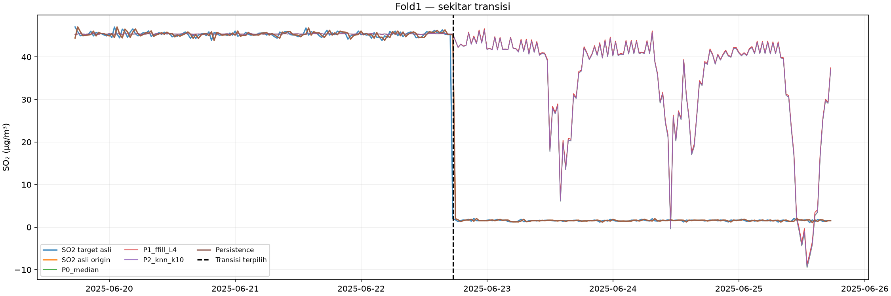
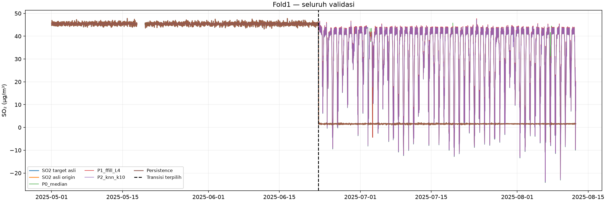
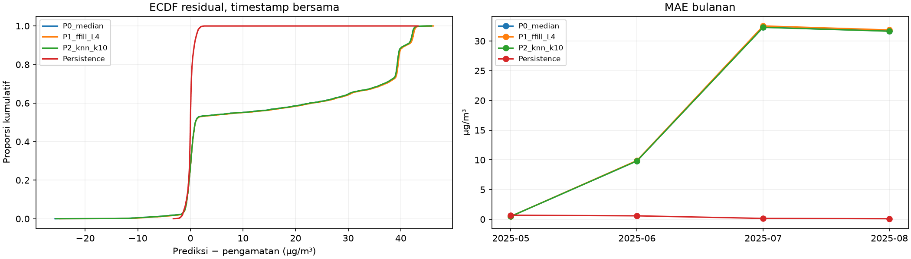

# Diagnosis kegagalan fold pertama tahap 6

**Tanpa fit model atau estimator baru, tuning, perubahan split maupun akses test akhir.** Seluruh prediksi, koefisien, mean dan scale berasal dari artefak fold pertama yang sudah tersimpan. Rekonstruksi hanya operasi aljabar atas parameter tersebut. Hasil lama dipertahankan.

## Penyelarasan prediksi dan sumber

Fold pertama: train kalender 2025-01-01 00:00:00 sampai 2025-04-30 23:30:00; target validasi 2025-05-01 00:00:00 sampai 2025-08-12 13:30:00. Train model setelah kalibrasi90hari dan buffer48slot hanya mencakup April, dengan 1379 target bersama pada rentang 43.53–47.43 µg/m³.

Seluruh 95 pemeriksaan tercantum pada workbook. Indeks target tepat origin+1, selisih timestamp tepat30menit, target finite sama dengan target asli. CSV fitur memiliki seluruh 10731 origin grid berurutan, termasuk slot berfitur kosong; seleksi finite memakai mask setelah penyusunan fitur. Tidak ditemukan perpindahan posisi akibat dropna/reindex. Lag0 sama dengan histori SO₂ pada origin; jika asli teramati nilainya harus sama persis. Untuk origin asli kosong, lag0 adalah hasil imputasi yang ditandai, bukan klaim pengamatan asli.

Ketujuh lag SO₂ dibandingkan pada seluruh origin terhadap shift histori tersimpan; seluruh kovariat asli dibandingkan dengan origin−30menit. Urutan34kolom saat rekonstruksi sama dengan urutan parameter tersimpan dan jalur kode fit/predict.

Excel sumber dibaca read_only sampai sekitar akhir validasi fold pertama (Agustus2025), sebelum batas test akhir. Seluruh nilai pada slot grid dibandingkan langsung dengan Excel; baris yang tidak tersedia dipastikan memiliki nilai grid kosong. Tidak ada Excel disimpan ulang.

| Variabel | Slot grid | Slot ada baris Excel | Slot tanpa baris | Ketidaksesuaian nilai | Satuan literal Excel |
|---|---|---|---|---|---|
| SO2 | 10732 | 10532 | 200 | 0 | µg/m³ |
| PM10 | 10732 | 10532 | 200 | 0 | µg/m³ |
| PM2.5 | 10732 | 10532 | 200 | 0 | µg/m³ |
| CO | 10732 | 10532 | 200 | 0 | µg/m³ |
| O3 | 10732 | 10532 | 200 | 0 | µg/m³ |
| NO2 | 10732 | 10532 | 200 | 0 | µg/m³ |
| Kec.Angin | 10732 | 10532 | 200 | 0 | m/s |
| Kelembaban | 10732 | 10532 | 200 | 0 | % |
| Suhu | 10732 | 10532 | 200 | 0 | °C |
| Tek.Udara | 10732 | 10532 | 200 | 0 | mBar |
| Sol.Rad | 10732 | 10532 | 200 | 0 | watt/m² |

Contoh pemeriksaan sel sumber (daftar lengkap beserta nomor sel ada di workbook):

| Peran | Timestamp grid | Sel SO2 | SO2 literal Excel | SO2 grid audit |
|---|---|---|---|---|
| origin | 2025-06-22 17:00:00 | E8108 | 45.25 | 45.25 |
| target | 2025-06-22 17:30:00 | E8109 | 1.98 | 1.98 |
| origin | 2025-06-22 17:30:00 | E8109 | 1.98 | 1.98 |
| target | 2025-06-22 18:00:00 | E8110 | 1.72 | 1.72 |
| origin | 2025-06-22 18:00:00 | E8110 | 1.72 | 1.72 |
| target | 2025-06-22 18:30:00 | E8111 | 1.30 | 1.30 |

Timestamp off-grid sumber dilaporkan terpisah pada workbook, tidak dibulatkan dan tidak menggeser grid. SO₂ pada baris off-grid ini kosong menurut audit sebelumnya.

## Scaling dan rekonstruksi keluaran

Mean dan scale seluruh34fitur dihitung ulang secara deskriptif dari timestamp train bersama tersimpan, lalu dibandingkan dengan parameter scaler. Semuanya cocok; kode tahap6 menempatkan `StandardScaler().fit(X[ids])` sebelum transform validasi. Tidak ada scaling target: Ridge dilatih terhadap SO₂ asli dalam satuan file. Karena itu tidak diperlukan inverse transform target. Intercept cocok dengan mean target train.

Persamaan setiap prediksi: ŷ = intercept + Σ βⱼ (xⱼ−mean_trainⱼ)/scale_trainⱼ. Rekonstruksi cocok dengan prediksi tersimpan pada semua timestamp pipeline yang finite; galat maksimum numerik:

| Pipeline | Alpha | Intercept | Train N | Train R2 deskriptif | Jumlah slope SO2 satuan asli | Maks galat prediksi rekonstruksi |
|---|---|---|---|---|---|---|
| P0_median | 1.00 | 45.40 | 1379 | 0.01 | 0.10 | 0.00 |
| P1_ffill_L4 | 1.00 | 45.40 | 1379 | 0.01 | 0.10 | 0.00 |
| P2_knn_k10 | 1.00 | 45.40 | 1379 | 0.01 | 0.10 | 0.00 |

Tidak ditemukan indikasi penggunaan scaler validasi, kolom tertukar, target salah skala atau inverse transform yang hilang. Statistik minimum, persentil, mean dan SD target asli/prediksi per metode, bulan, serta domain mandiri/bersama ada pada sheet Statistik_target_prediksi.

| Pipeline | Origin rendah asli N | Origin rendah median | Target median | Prediksi median | Prediksi mean | Prediksi minimum | Prediksi maksimum | MAE |
|---|---|---|---|---|---|---|---|---|
| P0_median | 2400 | 1.56 | 1.56 | 40.65 | 33.42 | -24.17 | 47.29 | 32.498173 |
| P1_ffill_L4 | 2400 | 1.56 | 1.56 | 40.81 | 33.70 | -23.25 | 47.70 | 32.714053 |
| P2_knn_k10 | 2400 | 1.56 | 1.56 | 40.63 | 33.40 | -24.05 | 47.33 | 32.475173 |
| Persistence | 2400 | 1.56 | 1.56 | 1.56 | 1.56 | 1.07 | 2.10 | 0.140817 |

“Origin rendah” di sini berarti SO₂ asli ≤2,14 µg/m³, penelusur hasil lama dan bukan ambang sensor/kualitas/bahaya. Statistik ini memakai origin yang asli teramati dan timestamp evaluasi bersama. Prediksi Ridge tetap jauh di atas konsentrasi rendah meskipun lag0 sudah rendah; tidak semua prediksi harus selalu tinggi, sehingga rentang lengkap dan prediksi negatif juga ditampilkan.

## Ridge, variasi fitur dan penalti

Konfigurasi tetap alpha=1, fit_intercept=True, solver=svd. Koefisien di workbook menyertakan urutan fitur, mean, scale, koefisien standar dan koefisien pada satuan asli. Fungsi objektif SSE+alpha×Σβ² memberi penalti L2 pada **semua34koefisien**, termasuk17indikator missing, polutan dan meteorologi; intercept tidak dipenalti. Tidak ada pengecualian khusus untuk meteorologi atau indikator. Kondisi stasioner Xstandarᵀ(ŷ−y)+alphaβ≈0 dan Σ(ŷ−y)≈0 diverifikasi dari parameter lama, tanpa menyelesaikan fit baru.

| Pipeline | Fitur | Koefisien standar | Koefisien satuan asli | Mean fitur train | Scale fitur train |
|---|---|---|---|---|---|
| P0_median | SO2_lag0 | 0.02 | 0.04 | 45.40 | 0.63 |
| P0_median | SO2_lag1 | 0.01 | 0.02 | 45.40 | 0.63 |
| P0_median | SO2_lag2 | -0.00 | -0.01 | 45.40 | 0.63 |
| P0_median | SO2_lag6 | -0.00 | -0.01 | 45.40 | 0.63 |
| P0_median | SO2_lag12 | 0.02 | 0.04 | 45.40 | 0.63 |
| P0_median | SO2_lag24 | 0.01 | 0.02 | 45.40 | 0.63 |
| P0_median | SO2_lag48 | 0.00 | 0.00 | 45.40 | 0.63 |
| P1_ffill_L4 | SO2_lag0 | 0.02 | 0.04 | 45.40 | 0.62 |
| P1_ffill_L4 | SO2_lag1 | 0.01 | 0.02 | 45.40 | 0.63 |
| P1_ffill_L4 | SO2_lag2 | -0.00 | -0.01 | 45.41 | 0.62 |
| P1_ffill_L4 | SO2_lag6 | -0.00 | -0.01 | 45.40 | 0.63 |
| P1_ffill_L4 | SO2_lag12 | 0.03 | 0.04 | 45.41 | 0.63 |
| P1_ffill_L4 | SO2_lag24 | 0.01 | 0.01 | 45.40 | 0.63 |
| P1_ffill_L4 | SO2_lag48 | 0.00 | 0.00 | 45.40 | 0.63 |
| P2_knn_k10 | SO2_lag0 | 0.02 | 0.04 | 45.40 | 0.62 |
| P2_knn_k10 | SO2_lag1 | 0.01 | 0.02 | 45.40 | 0.63 |
| P2_knn_k10 | SO2_lag2 | -0.00 | -0.01 | 45.40 | 0.62 |
| P2_knn_k10 | SO2_lag6 | -0.00 | -0.00 | 45.40 | 0.62 |
| P2_knn_k10 | SO2_lag12 | 0.02 | 0.04 | 45.40 | 0.63 |
| P2_knn_k10 | SO2_lag24 | 0.01 | 0.02 | 45.40 | 0.63 |
| P2_knn_k10 | SO2_lag48 | 0.00 | 0.00 | 45.40 | 0.63 |

Variasi lag0 dan pergeseran pada validasi bersama:

| Pipeline | Train minimum | Train median | Train maksimum | Train SD | Train nilai unik | Validasi minimum | Validasi median | Validasi maksimum | Di luar minmax train persen | Abs z lebih5 |
|---|---|---|---|---|---|---|---|---|---|---|
| P0_median | 43.53 | 45.40 | 47.43 | 0.63 | 285 | 1.07 | 43.69 | 47.81 | 50.052 | 2400 |
| P1_ffill_L4 | 43.53 | 45.40 | 47.43 | 0.62 | 284 | 1.07 | 43.50 | 47.81 | 50.114 | 2403 |
| P2_knn_k10 | 43.53 | 45.40 | 47.43 | 0.62 | 290 | 1.07 | 43.50 | 47.81 | 50.114 | 2403 |

Lag0 tidak konstan persis, tetapi variasinya kecil dibanding perpindahan ke konsentrasi sekitar1–2: mean≈45,4 dan SD≈0,62 pada train. Saat origin≈1,56, z lag0 sekitar−70; slope pada satuan asli hanya sekitar0,04, sehingga kontribusi lag0 sekitar−1,6, tidak cukup membawa intercept≈45,4 menuju1,56. Jumlah slope ketujuh SO₂ historis juga jauh dari1. Jumlah slope adalah sensitivitas aljabar jika seluruh lag bergerak satu unit bersamaan, bukan efek kausal atau atribusi independen antar lag berkorelasi.

Rata-rata kontribusi saat origin asli rendah, pada timestamp bersama:

| Pipeline | N | Intercept | SO2 historis | Polutan lain | Meteorologi | Indikator SO2 missing | Indikator kovariat missing | Prediksi mean |
|---|---|---|---|---|---|---|---|---|
| P0_median | 2400 | 45.40 | -4.41 | -0.50 | -7.07 | -0.00 | 0.00 | 33.42 |
| P1_ffill_L4 | 2400 | 45.40 | -4.26 | -0.51 | -6.93 | -0.00 | 0.00 | 33.70 |
| P2_knn_k10 | 2400 | 45.40 | -4.43 | -0.50 | -7.07 | -0.00 | 0.00 | 33.40 |

Jumlah kontribusi+intercept persis merekonstruksi prediksi. Kontribusi rinci setiap fitur pada sampel terpilih dan kontribusi kelompok pada seluruh prediksi ada di workbook. Korelasi Pearson tiap fitur numerik dengan target train juga dicatat. R² train yang rendah dan respons SO₂ historis yang kecil mendukung bahwa model terutama mempelajari tingkat rata-rata dalam cohort sempit. Ini bukan bukti alpha=1 sebagai penyebab tunggal: tanpa eksperimen pembanding yang diizinkan, pengaruh penalti tidak dapat dipisahkan dari hubungan train, korelasi fitur dan keterbatasan representasi.

Variasi seluruh fitur:

| Fitur | Train minimum | Train maksimum | Train SD | Konstan persis train | Validasi minimum | Validasi maksimum | Di luar minmax train persen | Abs z lebih5 |
|---|---|---|---|---|---|---|---|---|
| SO2_lag0 | 43.53 | 47.43 | 0.63 | False | 1.07 | 47.81 | 50.052 | 2400 |
| SO2_lag1 | 43.53 | 47.43 | 0.63 | False | 1.07 | 47.81 | 50.094 | 2402 |
| SO2_lag2 | 43.53 | 47.43 | 0.63 | False | 1.07 | 47.81 | 50.010 | 2398 |
| SO2_lag6 | 43.53 | 47.43 | 0.63 | False | 1.07 | 47.81 | 49.906 | 2393 |
| SO2_lag12 | 43.53 | 47.43 | 0.63 | False | 1.07 | 47.81 | 49.782 | 2387 |
| SO2_lag24 | 43.53 | 47.43 | 0.63 | False | 1.07 | 47.81 | 49.532 | 2375 |
| SO2_lag48 | 43.53 | 47.43 | 0.63 | False | 1.07 | 47.81 | 49.013 | 2351 |
| PM10_lag1 | 11.53 | 17.45 | 0.78 | False | 2.10 | 131.11 | 40.075 | 1743 |
| PM2.5_lag1 | 10.13 | 11.63 | 0.22 | False | 1.60 | 100.90 | 46.622 | 2186 |
| CO_lag1 | 501.60 | 608.90 | 17.23 | False | 174.44 | 622.16 | 50.010 | 2396 |
| O3_lag1 | 24.50 | 30.56 | 0.94 | False | 2.07 | 31.16 | 50.031 | 2402 |
| NO2_lag1 | 5.83 | 6.96 | 0.16 | False | 4.91 | 12.85 | 49.615 | 2380 |
| Kec.Angin_lag1 | 1.84 | 2.88 | 0.16 | False | 0.19 | 222.62 | 46.872 | 2147 |
| Kelembaban_lag1 | 82.09 | 85.77 | 0.57 | False | 51.55 | 98.58 | 41.987 | 1811 |
| Suhu_lag1 | 29.10 | 30.55 | 0.22 | False | 21.51 | 49.67 | 41.613 | 1832 |
| Tek.Udara_lag1 | 1008.55 | 1009.29 | 0.11 | False | 935.98 | 1017.75 | 45.167 | 2080 |
| Sol.Rad_lag1 | 7.54 | 9.28 | 0.27 | False | 0.11 | 956.68 | 49.345 | 2360 |

Rentang train, jumlah nilai unik, SD dan CV disajikan tanpa menetapkan ambang sensor. |z|>5 dan di luar min–maks train hanya deskripsi perpindahan fitur, bukan alasan menghapus data. Indikator yang selalu nol pada train tidak memiliki variasi untuk mempelajari efek missing; scale konstannya1 dan koefisiennya secara numerik mendekati nol. Sebagian fitur meteorologi memiliki SD kecil, sehingga pergeseran yang moderat pada satuan asli dapat menghasilkan z besar.

Contoh konkret ekstrapolasi meteorologi P0: Sol.Rad lag1 memiliki rentang train 7.54–9.28, sementara maksimum validasi bersama 956.68, pada satuan literal sumber. Dengan scale train 0.269151, maksimum tersebut menjadi z≈3523.2; kontribusi fitur ini sendiri ≈-64.52 µg/m³. Karena kontribusi dijumlahkan dengan intercept dan fitur lain, ekstrapolasi ini juga menjelaskan kemungkinan prediksi sangat rendah/negatif, selain kegagalan mengikuti tingkat rendah. Tidak menyatakan nilai meteorologi itu salah: kecocokan dengan Excel diverifikasi, tetapi validitas fisik dan dokumentasinya belum dipastikan.

## Transisi dan kelanjutan error

Penurunan SO2 asli terbesar antara dua slot berurutan30menit pada validasi fold1; keduanya finite; ikatan dipilih waktu paling awal. Tidak memakai residual/prediksi.

| Timestamp sebelum | SO2 sebelum | Timestamp transisi | SO2 sesudah | Selisih SO2 |
|---|---|---|---|---|
| 2025-06-22 17:00:00 | 45.25 | 2025-06-22 17:30:00 | 1.98 | -43.27 |

Jendela grafik lokal dipatok ±72jam, dan grafik seluruh validasi disertakan agar error jauh setelah transisi tetap terlihat. SO₂ pada origin diplot pada timestamp target pasangannya; label ini adalah nilai tersedia30menit sebelumnya. Garis memiliki celah ketika baris evaluasi atau nilainya kosong.

| Pipeline | Periode | N | MAE | RMSE | Bias |
|---|---|---|---|---|---|
| P0_median | seluruh fold | 4811 | 16.491830 | 24.456627 | 15.916489 |
| P0_median | 2025-05 | 1364 | 0.496319 | 0.612869 | -0.012192 |
| P0_median | 2025-06 | 1440 | 9.834487 | 18.808382 | 9.405593 |
| P0_median | 2025-07 | 1455 | 32.315470 | 34.449619 | 31.709672 |
| P0_median | 2025-08 | 552 | 31.674895 | 34.074402 | 30.632666 |
| P1_ffill_L4 | seluruh fold | 4811 | 16.599086 | 24.601243 | 16.058483 |
| P1_ffill_L4 | 2025-05 | 1364 | 0.496314 | 0.612933 | -0.012252 |
| P1_ffill_L4 | 2025-06 | 1440 | 9.896901 | 18.919501 | 9.477615 |
| P1_ffill_L4 | 2025-07 | 1455 | 32.536764 | 34.658911 | 31.998630 |
| P1_ffill_L4 | 2025-08 | 552 | 31.863586 | 34.261301 | 30.920829 |
| P2_knn_k10 | seluruh fold | 4811 | 16.479999 | 24.436651 | 15.907770 |
| P2_knn_k10 | 2025-05 | 1364 | 0.496322 | 0.612798 | -0.012175 |
| P2_knn_k10 | 2025-06 | 1440 | 9.825047 | 18.788477 | 9.397263 |
| P2_knn_k10 | 2025-07 | 1455 | 32.295598 | 34.425411 | 31.696282 |
| P2_knn_k10 | 2025-08 | 552 | 31.648787 | 34.042613 | 30.613659 |
| Persistence | seluruh fold | 4811 | 0.429472 | 0.887766 | 0.009588 |
| Persistence | 2025-05 | 1364 | 0.691100 | 0.861007 | 0.001085 |
| Persistence | 2025-06 | 1440 | 0.588215 | 1.372660 | 0.030632 |
| Persistence | 2025-07 | 1455 | 0.151333 | 0.198839 | 0.000254 |
| Persistence | 2025-08 | 552 | 0.102011 | 0.132879 | 0.000308 |

Skor berdasarkan jarak dari transisi, seluruhnya pada timestamp bersama:

| Pipeline | Periode | N | Target median | Prediksi median | MAE | RMSE | Bias | Abs residual lebih lebar train |
|---|---|---|---|---|---|---|---|---|
| P0_median | sebelum transisi | 2407 | 45.38 | 45.40 | 0.502993 | 0.628543 | -0.002351 | 0 |
| P0_median | 0–48 jam | 96 | 1.56 | 40.78 | 35.246300 | 36.464168 | 35.204475 | 95 |
| P0_median | 48 jam–7 hari | 240 | 1.56 | 40.63 | 33.600483 | 35.174915 | 33.266483 | 232 |
| P0_median | lebih atau sama7hari | 2068 | 1.56 | 40.64 | 32.245516 | 34.434119 | 31.535928 | 1987 |
| P1_ffill_L4 | sebelum transisi | 2407 | 45.38 | 45.40 | 0.503001 | 0.628554 | -0.002373 | 0 |
| P1_ffill_L4 | 0–48 jam | 96 | 1.56 | 40.93 | 35.457684 | 36.651863 | 35.429153 | 95 |
| P1_ffill_L4 | 48 jam–7 hari | 240 | 1.56 | 40.78 | 33.826662 | 35.392309 | 33.539278 | 233 |
| P1_ffill_L4 | lebih atau sama7hari | 2068 | 1.56 | 40.81 | 32.458966 | 34.638070 | 31.824200 | 1981 |
| P2_knn_k10 | sebelum transisi | 2407 | 45.38 | 45.40 | 0.503014 | 0.628523 | -0.002343 | 0 |
| P2_knn_k10 | 0–48 jam | 96 | 1.56 | 40.77 | 35.230423 | 36.445456 | 35.190161 | 95 |
| P2_knn_k10 | 48 jam–7 hari | 240 | 1.56 | 40.62 | 33.602324 | 35.174741 | 33.273876 | 232 |
| P2_knn_k10 | lebih atau sama7hari | 2068 | 1.56 | 40.63 | 32.218493 | 34.402051 | 31.515443 | 1986 |
| Persistence | sebelum transisi | 2407 | 45.38 | 45.38 | 0.699958 | 0.873222 | 0.000823 | 0 |
| Persistence | 0–48 jam | 96 | 1.56 | 1.56 | 0.601146 | 4.421260 | 0.454271 | 1 |
| Persistence | 48 jam–7 hari | 240 | 1.56 | 1.56 | 0.163292 | 0.211946 | 0.000208 | 0 |
| Persistence | lebih atau sama7hari | 2068 | 1.56 | 1.56 | 0.137568 | 0.182622 | 0.000237 | 0 |

Error tidak terbatas pada satu slot pergantian: tabel >7hari dan skor Juli/Agustus memperlihatkan error menetap sesudah transisi. “Residual besar” untuk penelusuran ini berarti |residual| lebih besar daripada lebar target train bersama, yakni 3.90 µg/m³; batas deskriptif dari train, bukan ambang kualitas.

| Pipeline | Periode | N | Minimum | P1 | P5 | Median | P95 | P99 | Maksimum | Mean | SD |
|---|---|---|---|---|---|---|---|---|---|---|---|
| P0_median | seluruh fold | 4811 | -25.74 | -6.83 | -1.01 | 0.95 | 42.13 | 42.57 | 45.82 | 15.92 | 18.57 |
| P0_median | 2025-05 | 1364 | -2.35 | -1.44 | -1.02 | 0.02 | 0.95 | 1.30 | 1.63 | -0.01 | 0.61 |
| P0_median | 2025-06 | 1440 | -11.21 | -1.70 | -0.96 | 0.31 | 41.66 | 42.52 | 44.91 | 9.41 | 16.29 |
| P0_median | 2025-07 | 1455 | -14.45 | -9.72 | -0.03 | 39.04 | 42.35 | 42.74 | 45.82 | 31.71 | 13.47 |
| P0_median | 2025-08 | 552 | -25.74 | -11.97 | -4.01 | 39.05 | 42.22 | 42.67 | 43.74 | 30.63 | 14.94 |
| P1_ffill_L4 | seluruh fold | 4811 | -24.82 | -6.13 | -0.99 | 0.96 | 42.38 | 42.83 | 46.23 | 16.06 | 18.64 |
| P1_ffill_L4 | 2025-05 | 1364 | -2.35 | -1.44 | -1.02 | 0.02 | 0.95 | 1.30 | 1.63 | -0.01 | 0.61 |
| P1_ffill_L4 | 2025-06 | 1440 | -10.47 | -1.66 | -0.96 | 0.31 | 41.90 | 42.78 | 45.13 | 9.48 | 16.38 |
| P1_ffill_L4 | 2025-07 | 1455 | -13.65 | -8.95 | 0.59 | 39.20 | 42.60 | 43.01 | 46.23 | 32.00 | 13.32 |
| P1_ffill_L4 | 2025-08 | 552 | -24.82 | -11.19 | -3.34 | 39.21 | 42.48 | 42.87 | 44.08 | 30.92 | 14.77 |
| P2_knn_k10 | seluruh fold | 4811 | -25.62 | -6.74 | -1.01 | 0.95 | 42.13 | 42.57 | 45.86 | 15.91 | 18.55 |
| P2_knn_k10 | 2025-05 | 1364 | -2.35 | -1.44 | -1.02 | 0.02 | 0.95 | 1.30 | 1.63 | -0.01 | 0.61 |
| P2_knn_k10 | 2025-06 | 1440 | -11.12 | -1.70 | -0.96 | 0.31 | 41.60 | 42.53 | 44.82 | 9.40 | 16.28 |
| P2_knn_k10 | 2025-07 | 1455 | -14.35 | -9.62 | 0.04 | 39.01 | 42.35 | 42.74 | 45.86 | 31.70 | 13.44 |
| P2_knn_k10 | 2025-08 | 552 | -25.62 | -11.87 | -3.93 | 39.02 | 42.22 | 42.61 | 43.77 | 30.61 | 14.90 |
| Persistence | seluruh fold | 4811 | -3.26 | -1.77 | -1.16 | 0.00 | 1.13 | 1.78 | 43.27 | 0.01 | 0.89 |
| Persistence | 2025-05 | 1364 | -3.26 | -1.89 | -1.44 | 0.01 | 1.42 | 1.93 | 2.54 | 0.00 | 0.86 |
| Persistence | 2025-06 | 1440 | -2.73 | -2.04 | -1.41 | 0.00 | 1.27 | 1.88 | 43.27 | 0.03 | 1.37 |
| Persistence | 2025-07 | 1455 | -0.70 | -0.50 | -0.35 | 0.00 | 0.33 | 0.48 | 0.73 | 0.00 | 0.20 |
| Persistence | 2025-08 | 552 | -0.80 | -0.30 | -0.20 | 0.00 | 0.22 | 0.29 | 0.52 | 0.00 | 0.13 |

## Persistence dan cakupan

Donor persistence diverifikasi sebagai pengamatan SO₂ asli terakhir pada atau sebelum origin, bukan hasil imputasi dan bukan pengamatan masa depan. Usia donor=indeks origin−indeks donor, satu slot30menit.

| Domain | Usia slot | Usia jam | Jumlah | Denominator target asli domain | Persen |
|---|---|---|---|---|---|
| semua target asli | 0 | 0.00 | 4885 | 4890 | 99.898 |
| semua target asli | 1 | 0.50 | 3 | 4890 | 0.061 |
| semua target asli | 4 | 2.00 | 1 | 4890 | 0.020 |
| semua target asli | 75 | 37.50 | 1 | 4890 | 0.020 |
| irisan bersama | 0 | 0.00 | 4808 | 4811 | 99.938 |
| irisan bersama | 1 | 0.50 | 3 | 4811 | 0.062 |

| Pipeline | N | Denominator target asli | Cakupan persen | MAE | RMSE | Bias | SHA256 timestamp |
|---|---|---|---|---|---|---|---|
| P0_median | 4811 | 4890 | 98.384 | 16.491830 | 24.456627 | 15.916489 | 5e0f4af08ba7ae2f5c7bd9a586bff1337c569070567ce2e463c9d87ff8712b33 |
| P1_ffill_L4 | 4811 | 4890 | 98.384 | 16.599086 | 24.601243 | 16.058483 | 5e0f4af08ba7ae2f5c7bd9a586bff1337c569070567ce2e463c9d87ff8712b33 |
| P2_knn_k10 | 4811 | 4890 | 98.384 | 16.479999 | 24.436651 | 15.907770 | 5e0f4af08ba7ae2f5c7bd9a586bff1337c569070567ce2e463c9d87ff8712b33 |
| Persistence | 4811 | 4890 | 98.384 | 0.429472 | 0.887766 | 0.009588 | 5e0f4af08ba7ae2f5c7bd9a586bff1337c569070567ce2e463c9d87ff8712b33 |

Cakupan (%)=prediksi finite/seluruh target asli teramati jendela×100. Skor bersama memakai digest timestamp identik. Workbook juga menyimpan skor mandiri dengan denominator target asli yang sama; skor mandiri tidak digunakan untuk mengklaim perbandingan terkontrol. MAE=Σ|e|/N; RMSE=√(Σe²/N); bias=Σe/N, e=prediksi−pengamatan. Distribusi residual memakai N pada domain yang dinyatakan.

## Klasifikasi temuan

**A. Kesalahan implementasi yang terbukti:** tidak ditemukan pada pemeriksaan ini. Alignment, grid, lag, urutan fitur, scaler train-only, target tanpa scaling, rekonstruksi prediksi dan baseline cocok. Ini bukan jaminan bahwa semua kemungkinan bug telah dibuktikan tidak ada. Tidak ada perbaikan atau penimpaan hasil lama.

**B. Keterbatasan model yang didukung pemeriksaan:** kalibrasi dan buffer meninggalkan cohort train tinggi dan sempit; Ridge memiliki intercept sekitar45,4 dan respons historis yang lemah, sehingga tidak mengikuti perpindahan ke tingkat rendah. Fitur validasi keluar jauh dari rentang train; error berlanjut lama setelah transisi. Gate minimal340sampel menguji kecukupan komputasional, bukan keterwakilan distribusi atau daya generalisasi. Kegagalan ini konsisten dengan konsekuensi rancangan dan keterbatasan model pada distribusi berbeda. Tidak ada tuning atau model tandingan untuk mengisolasi penyebab tunggal.

**C. Ketidakpastian data yang belum dapat dijelaskan:** penurunan SO₂ dan perubahan kovariat tercantum pada sumber, tetapi penyebab, keabsahan pengamatan, riwayat alat/kalibrasi, satuan atau kode yang perlu klarifikasi, keterlambatan pelaporan, serta zona waktu memerlukan penyedia data. Tidak menyimpulkan aktivitas vulkanik atau kerusakan sensor. Nilai tinggi/rendah dan transisi tidak dihapus.

Integritas: 157 berkas sumber/artefak lama memiliki SHA256 sebelum–sesudah identik. Tidak ada estimator di-fit dan test akhir tidak dibuka; hashing byte dilakukan hanya untuk integritas.

Artefak: `diagnosis_fold1.xlsx`, `diagnosis_fold1/aturan_diagnosis.json`, `diagnosis_fold1/prediksi_dan_origin.csv`, dan grafik `figures/diagnosis_fold1/`. Parameter lengkap, pemeriksaan, nilai sumber, kontribusi dan hash tersimpan dalam workbook.
