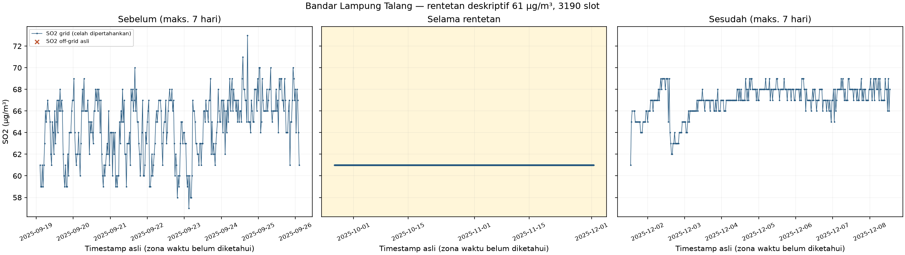
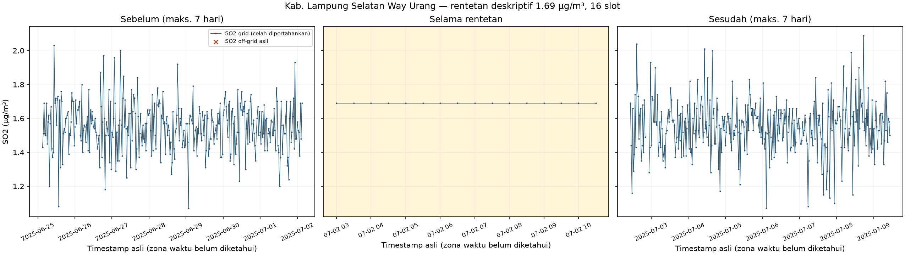
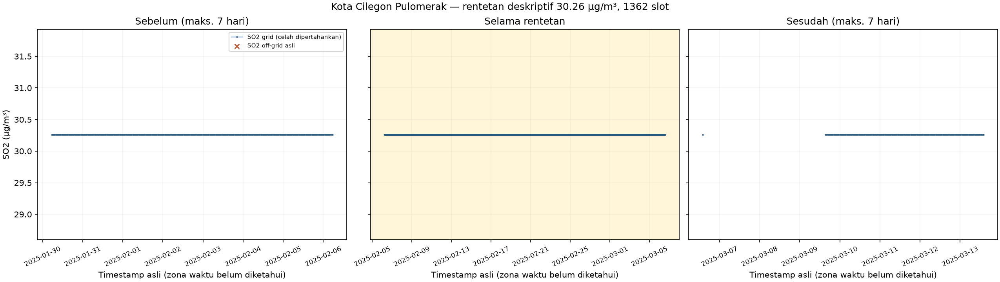
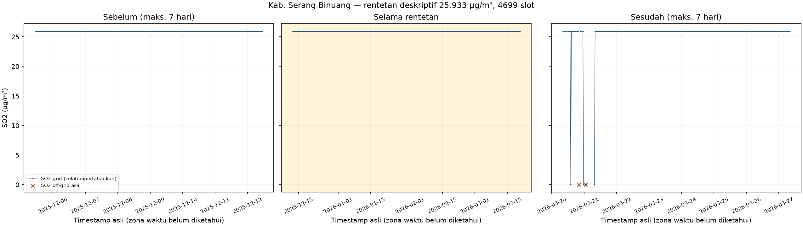
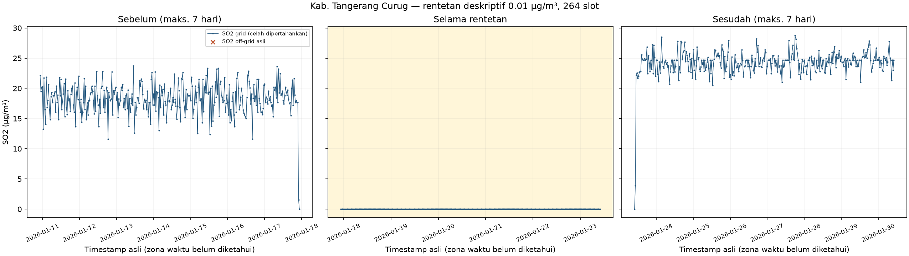
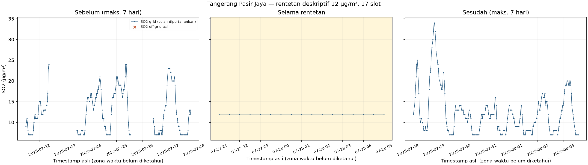
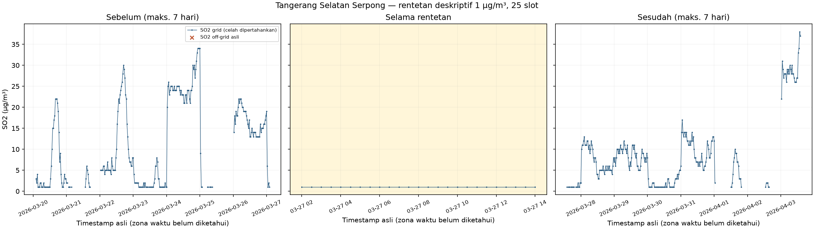
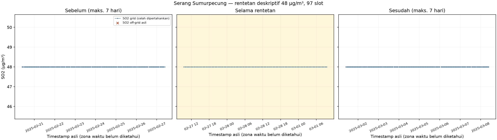

# Pemeriksaan lanjutan dan rancangan eksperimen preprocessing SO₂

**Status: usulan eksperimen, belum dijalankan.** Pemeriksaan menggunakan hasil audit tahap kedua, grid audit yang sudah tersedia, serta pembacaan ulang sumber hanya untuk verifikasi. Tidak ada imputasi, pembulatan waktu, agregasi, penghapusan nilai, scaling, pemilihan stasiun utama atau pelatihan model.

## 1. Definisi dan sumber

- Acuan: `notebooks/01_audit_data.ipynb`, `notebooks/02_audit_kualitas_data.ipynb`, `audit_struktur_data.json`, `audit_kualitas_tables.json`, `audit_kualitas_data.xlsx`, dan CSV grid tahap kedua.
- Workbook `pemeriksaan_lanjutan_kualitas.xlsx` memuat rekonsiliasi, semua 13 off-grid, 39 skenario pemetaan hipotetis, 80 rentetan SO₂, 960 pemeriksaan variabel lain, kelayakan setiap stasiun dan SHA256.
- SO₂ teramati grid (%) = 100 × slot dengan sedikitnya satu nilai SO₂ nonkosong / seluruh slot grid 30 menit stasiun. Nol, nilai berulang dan nilai tinggi tetap teramati, belum otomatis valid.
- Kehilangan awal/tengah/akhir dilaporkan dengan dua denominator: seluruh slot grid, dan seluruh slot SO₂ hilang. Tiga posisi tersebut mencakup seluruh kehilangan pada delapan stasiun ini.
- Kelengkapan meteorologi grid (%) memakai slot nonkosong variabel / seluruh slot grid. Tabel rinci juga menyajikan persentase nonkosong per seluruh baris sumber; denominator keduanya tidak dipertukarkan.
- Durasi slot rentetan konstan = jumlah slot × 30 menit. Rentang waktu = akhir − awal, lebih pendek satu slot. Pengelompokan gap tahap kedua tetap deskriptif dan belum menjadi batas imputasi.
- Tidak ada asumsi zona waktu, kode sensor, penyebab anomali, batas sensor atau kaitan dengan aktivitas Anak Krakatau.

## 2. Verifikasi timestamp di luar pola 00/30

Ditemukan kembali **13 baris off-grid**, dengan **6 nilai SO₂ nonkosong**. Timestamp sebelum/sesudah berikut mengikuti urutan baris asli. Selisih dalam menit.

| Stasiun | Baris Excel | Timestamp asli | SO2 asli | Waktu sebelum | Selisih dari sebelum menit | Waktu sesudah | Selisih ke sesudah menit |
|---|---|---|---|---|---|---|---|
| Kab. Lampung Selatan Way Urang | 6624 | 2025-05-22 19:01:00 | — | 2025-05-22 19:00:00 | 1.00 | 2025-05-22 19:30:00 | 29.00 |
| Kota Cilegon Pulomerak | 4394 | 2025-04-05 12:01:00 | — | 2025-04-05 11:30:00 | 31.00 | 2025-04-05 13:30:00 | 89.00 |
| Kota Cilegon Pulomerak | 4396 | 2025-04-05 14:01:00 | — | 2025-04-05 13:30:00 | 31.00 | 2025-04-05 15:00:00 | 59.00 |
| Kab. Serang Binuang | 20007 | 2026-03-20 20:01:00 | 0.01 | 2026-03-20 19:30:00 | 31.00 | 2026-03-20 21:00:00 | 59.00 |
| Kab. Serang Binuang | 20014 | 2026-03-21 01:01:00 | 0.01 | 2026-03-21 00:30:00 | 31.00 | 2026-03-21 01:30:00 | 29.00 |
| Kab. Serang Binuang | 27062 | 2026-08-25 12:01:00 | 0.01 | 2026-08-25 12:00:00 | 1.00 | 2026-08-25 12:30:00 | 29.00 |
| Kab. Serang Binuang | 27342 | 2026-08-31 08:01:00 | 0.01 | 2026-08-31 07:30:00 | 31.00 | 2026-08-31 09:01:00 | 60.00 |
| Kab. Serang Binuang | 27343 | 2026-08-31 09:01:00 | 0.01 | 2026-08-31 08:01:00 | 60.00 | 2026-09-01 13:30:00 | 1709.00 |
| Kab. Serang Binuang | 28098 | 2026-09-17 08:01:00 | 0.01 | 2026-09-17 08:00:00 | 1.00 | 2026-09-17 08:30:00 | 29.00 |
| Kab. Tangerang Curug | 3527 | 2025-03-20 11:01:00 | — | 2025-03-20 09:30:00 | 91.00 | 2025-03-20 13:03:00 | 122.00 |
| Kab. Tangerang Curug | 3528 | 2025-03-20 13:03:00 | — | 2025-03-20 11:01:00 | 122.00 | 2025-03-20 17:03:00 | 240.00 |
| Kab. Tangerang Curug | 3529 | 2025-03-20 17:03:00 | — | 2025-03-20 13:03:00 | 240.00 | 2025-03-20 20:01:00 | 178.00 |
| Kab. Tangerang Curug | 3530 | 2025-03-20 20:01:00 | — | 2025-03-20 17:03:00 | 178.00 | 2025-03-20 21:30:00 | 89.00 |

### Rekonsiliasi terhadap tahap kedua

| Stasiun | Seluruh baris sumber | Baris pada grid | Baris off-grid terpisah | SO2 nonkosong seluruh baris | SO2 nonkosong pada grid | SO2 nonkosong off-grid terpisah |
|---|---|---|---|---|---|---|
| Bandar Lampung Talang | 28226 | 28226 | 0 | 26189 | 26189 | 0 |
| Kab. Lampung Selatan Way Urang | 29966 | 29965 | 1 | 28246 | 28246 | 0 |
| Kota Cilegon Pulomerak | 30399 | 30397 | 2 | 25439 | 25439 | 0 |
| Kab. Serang Binuang | 28732 | 28726 | 6 | 28727 | 28721 | 6 |
| Kab. Tangerang Curug | 30137 | 30133 | 4 | 30010 | 30010 | 0 |
| Tangerang Pasir Jaya | 23674 | 23674 | 0 | 3569 | 3569 | 0 |
| Tangerang Selatan Serpong | 25080 | 25080 | 0 | 14184 | 14184 | 0 |
| Serang Sumurpecung | 25444 | 25444 | 0 | 23711 | 23711 | 0 |

Untuk setiap stasiun, jumlah baris pada grid + off-grid = seluruh baris sumber. Jumlah SO₂ nonkosong pada grid + off-grid = seluruh SO₂ nonkosong sumber. Tidak ada timestamp gagal atau duplikat pada data ini. Numerator kelengkapan tahap kedua sama dengan SO₂ nonkosong **pada grid**. Off-grid sudah dihitung dalam statistik per baris sumber, tetapi dikeluarkan dari numerator kelengkapan grid. Jadi reindex grid saja tidak merepresentasikan seluruh pengamatan. Baris off-grid dipertahankan sebagai ledger terpisah; hasil grid tidak boleh digunakan sebagai pengganti sumber atau satu-satunya inventaris.

### Konsekuensi kebijakan waktu — belum diterapkan

- **Pertahankan timestamp asli:** menyimpan semua pengamatan dan kronologi. Model reguler perlu ledger off-grid, fitur selisih waktu/mask, atau kebijakan pembentukan fitur tersendiri; timestamp tidak boleh diam-diam dibuang.
- **Petakan ke slot floor/ceil/terdekat:** mengubah label waktu dan berpotensi menempatkan beberapa baris pada satu slot. Simpan timestamp asli, slot kandidat, selisih dan identitas baris. Putuskan kebijakan benturan dengan penyedia data; jangan mengambil baris pertama, terakhir atau rata-rata tanpa alasan. Pemetaan terdekat/floor dapat menempatkan pengamatan lebih awal daripada waktu aslinya, sehingga dapat membocorkan informasi bila dianggap tersedia di slot lebih awal.
- **Agregasi interval:** misalnya interval berlabel akhir `(t−30 menit, t]`, hanya menggunakan pengamatan yang sudah tersedia sampai t. Mean/median mengubah nilai, bobot dan makna observasi; jumlah sampel, konflik dan cakupan interval harus disimpan. Jangan mengagregasi sebelum diketahui apakah timestamp menyatakan waktu sesaat, awal/akhir interval atau rata-rata pengukuran. Label interval tidak menentukan waktu kedatangan data.
- **Ketersediaan aktual:** gunakan waktu kedatangan/latensi bila tersedia. Selama metadata itu belum ada, jangan menganggap nilai tersedia sebelum timestamp aslinya; eksperimen harus menyatakan asumsi latensi yang dipakai.
- Tabel `Pemetaan_hipotetis` hanya menghitung kandidat dan kemungkinan benturan, tidak mengubah timestamp atau nilai.

- Skenario floor: 3 dari 13 baris off-grid akan berbenturan dengan baris lain pada slot kandidat. Jumlah ini menghitung baris off-grid terdampak, bukan jumlah slot unik.
- Skenario ceil: 4 dari 13 baris off-grid akan berbenturan dengan baris lain pada slot kandidat. Jumlah ini menghitung baris off-grid terdampak, bukan jumlah slot unik.
- Skenario terdekat: 3 dari 13 baris off-grid akan berbenturan dengan baris lain pada slot kandidat. Jumlah ini menghitung baris off-grid terdampak, bukan jumlah slot unik.

## 3. Pemetaan rentetan SO₂ konstan

Sepuluh rentetan terpanjang tiap stasiun disalin dari hasil tahap kedua. Pemeriksaan variabel lain memakai seluruh baris asli pada interval awal–akhir, termasuk off-grid. Konstan pada nilai tersedia tidak berarti lengkap di seluruh interval. Nilai kosong dan jumlah unik tersedia ditampilkan pada `Konteks_variabel`; tidak ada label kerusakan sensor.

### Bandar Lampung Talang

| Peringkat | Nilai SO2 | Awal | Akhir | Jumlah slot | Durasi slot jam | Rentang waktu jam | Penanda deskriptif |
|---|---|---|---|---|---|---|---|
| 1 | 61.00 | 2025-09-26 02:30:00 | 2025-12-01 13:00:00 | 3190 | 1595.00 | 1594.50 | SO2 konstan; 10 variabel lain berubah, 2 konstan tersedia, 0 bukti tidak cukup |
| 2 | 23.00 | 2026-07-03 00:00:00 | 2026-08-11 08:00:00 | 1889 | 944.50 | 944.00 | SO2 konstan; 10 variabel lain berubah, 2 konstan tersedia, 0 bukti tidak cukup |
| 3 | 69.00 | 2025-06-25 17:30:00 | 2025-06-28 04:30:00 | 119 | 59.50 | 59.00 | SO2 konstan; 8 variabel lain berubah, 4 konstan tersedia, 0 bukti tidak cukup |
| 4 | 52.00 | 2025-04-10 17:30:00 | 2025-04-11 10:30:00 | 35 | 17.50 | 17.00 | SO2 konstan; 7 variabel lain berubah, 1 konstan tersedia, 4 bukti tidak cukup |
| 5 | 58.00 | 2025-01-13 09:30:00 | 2025-01-13 21:00:00 | 24 | 12.00 | 11.50 | SO2 konstan; 3 variabel lain berubah, 8 konstan tersedia, 1 bukti tidak cukup |
| 6 | 58.00 | 2025-01-26 00:00:00 | 2025-01-26 07:30:00 | 16 | 8.00 | 7.50 | SO2 konstan; 3 variabel lain berubah, 8 konstan tersedia, 1 bukti tidak cukup |
| 7 | 67.00 | 2025-12-04 03:00:00 | 2025-12-04 09:30:00 | 14 | 7.00 | 6.50 | SO2 konstan; 9 variabel lain berubah, 3 konstan tersedia, 0 bukti tidak cukup |
| 8 | 61.00 | 2025-01-29 02:00:00 | 2025-01-29 07:30:00 | 12 | 6.00 | 5.50 | SO2 konstan; 3 variabel lain berubah, 8 konstan tersedia, 1 bukti tidak cukup |
| 9 | 62.00 | 2025-03-18 11:00:00 | 2025-03-18 16:30:00 | 12 | 6.00 | 5.50 | SO2 konstan; 4 variabel lain berubah, 7 konstan tersedia, 1 bukti tidak cukup |
| 10 | 64.00 | 2025-03-24 11:00:00 | 2025-03-24 16:30:00 | 12 | 6.00 | 5.50 | SO2 konstan; 4 variabel lain berubah, 7 konstan tersedia, 1 bukti tidak cukup |

Grafik menampilkan maksimum tujuh hari sebelum, seluruh rentetan, dan maksimum tujuh hari sesudah. Celah tetap terlihat; titik off-grid ditandai terpisah. Konteks dibatasi rentang sumber.

### Kab. Lampung Selatan Way Urang

| Peringkat | Nilai SO2 | Awal | Akhir | Jumlah slot | Durasi slot jam | Rentang waktu jam | Penanda deskriptif |
|---|---|---|---|---|---|---|---|
| 1 | 1.69 | 2025-07-02 03:00:00 | 2025-07-02 10:30:00 | 16 | 8.00 | 7.50 | SO2 konstan; 2 variabel lain berubah, 9 konstan tersedia, 1 bukti tidak cukup |
| 2 | 1.39 | 2025-02-13 23:00:00 | 2025-02-14 00:30:00 | 4 | 2.00 | 1.50 | SO2 konstan; 10 variabel lain berubah, 0 konstan tersedia, 2 bukti tidak cukup |
| 3 | 1.37 | 2025-02-24 03:00:00 | 2025-02-24 04:30:00 | 4 | 2.00 | 1.50 | SO2 konstan; 11 variabel lain berubah, 0 konstan tersedia, 1 bukti tidak cukup |
| 4 | 1.78 | 2025-01-17 20:00:00 | 2025-01-17 21:00:00 | 3 | 1.50 | 1.00 | SO2 konstan; 11 variabel lain berubah, 1 konstan tersedia, 0 bukti tidak cukup |
| 5 | 1.43 | 2025-02-18 00:00:00 | 2025-02-18 01:00:00 | 3 | 1.50 | 1.00 | SO2 konstan; 10 variabel lain berubah, 0 konstan tersedia, 2 bukti tidak cukup |
| 6 | 1.40 | 2025-02-20 22:30:00 | 2025-02-20 23:30:00 | 3 | 1.50 | 1.00 | SO2 konstan; 11 variabel lain berubah, 0 konstan tersedia, 1 bukti tidak cukup |
| 7 | 1.38 | 2025-02-25 17:30:00 | 2025-02-25 18:30:00 | 3 | 1.50 | 1.00 | SO2 konstan; 11 variabel lain berubah, 0 konstan tersedia, 1 bukti tidak cukup |
| 8 | 1.39 | 2025-02-26 13:00:00 | 2025-02-26 14:00:00 | 3 | 1.50 | 1.00 | SO2 konstan; 11 variabel lain berubah, 0 konstan tersedia, 1 bukti tidak cukup |
| 9 | 1.40 | 2025-02-27 17:00:00 | 2025-02-27 18:00:00 | 3 | 1.50 | 1.00 | SO2 konstan; 11 variabel lain berubah, 0 konstan tersedia, 1 bukti tidak cukup |
| 10 | 1.37 | 2025-02-28 01:00:00 | 2025-02-28 02:00:00 | 3 | 1.50 | 1.00 | SO2 konstan; 11 variabel lain berubah, 0 konstan tersedia, 1 bukti tidak cukup |

Grafik menampilkan maksimum tujuh hari sebelum, seluruh rentetan, dan maksimum tujuh hari sesudah. Celah tetap terlihat; titik off-grid ditandai terpisah. Konteks dibatasi rentang sumber.

### Kota Cilegon Pulomerak

| Peringkat | Nilai SO2 | Awal | Akhir | Jumlah slot | Durasi slot jam | Rentang waktu jam | Penanda deskriptif |
|---|---|---|---|---|---|---|---|
| 1 | 30.26 | 2025-02-06 05:30:00 | 2025-03-06 14:00:00 | 1362 | 681.00 | 680.50 | SO2 konstan; 0 variabel lain berubah, 2 konstan tersedia, 10 bukti tidak cukup |
| 2 | 30.26 | 2025-01-05 18:00:00 | 2025-01-29 00:30:00 | 1118 | 559.00 | 558.50 | SO2 konstan; 0 variabel lain berubah, 2 konstan tersedia, 10 bukti tidak cukup |
| 3 | 30.26 | 2025-12-17 02:30:00 | 2026-01-03 18:30:00 | 849 | 424.50 | 424.00 | SO2 konstan; 0 variabel lain berubah, 2 konstan tersedia, 10 bukti tidak cukup |
| 4 | 30.26 | 2025-03-09 15:30:00 | 2025-03-18 13:30:00 | 429 | 214.50 | 214.00 | SO2 konstan; 0 variabel lain berubah, 2 konstan tersedia, 10 bukti tidak cukup |
| 5 | 30.26 | 2025-01-29 01:30:00 | 2025-02-06 04:30:00 | 391 | 195.50 | 195.00 | SO2 konstan; 0 variabel lain berubah, 2 konstan tersedia, 10 bukti tidak cukup |
| 6 | 30.26 | 2025-06-02 13:30:00 | 2025-06-10 14:30:00 | 387 | 193.50 | 193.00 | SO2 konstan; 0 variabel lain berubah, 2 konstan tersedia, 10 bukti tidak cukup |
| 7 | 30.26 | 2026-01-07 18:00:00 | 2026-01-14 15:00:00 | 331 | 165.50 | 165.00 | SO2 konstan; 0 variabel lain berubah, 2 konstan tersedia, 10 bukti tidak cukup |
| 8 | 30.26 | 2025-05-05 07:00:00 | 2025-05-12 02:30:00 | 328 | 164.00 | 163.50 | SO2 konstan; 0 variabel lain berubah, 2 konstan tersedia, 10 bukti tidak cukup |
| 9 | 30.26 | 2026-01-21 18:00:00 | 2026-01-26 17:00:00 | 239 | 119.50 | 119.00 | SO2 konstan; 0 variabel lain berubah, 2 konstan tersedia, 10 bukti tidak cukup |
| 10 | 30.26 | 2026-01-14 18:00:00 | 2026-01-18 18:30:00 | 194 | 97.00 | 96.50 | SO2 konstan; 0 variabel lain berubah, 2 konstan tersedia, 10 bukti tidak cukup |

Grafik menampilkan maksimum tujuh hari sebelum, seluruh rentetan, dan maksimum tujuh hari sesudah. Celah tetap terlihat; titik off-grid ditandai terpisah. Konteks dibatasi rentang sumber.

### Kab. Serang Binuang

| Peringkat | Nilai SO2 | Awal | Akhir | Jumlah slot | Durasi slot jam | Rentang waktu jam | Penanda deskriptif |
|---|---|---|---|---|---|---|---|
| 1 | 25.93 | 2025-12-12 11:00:00 | 2026-03-20 08:00:00 | 4699 | 2349.50 | 2349.00 | SO2 konstan; 0 variabel lain berubah, 12 konstan tersedia, 0 bukti tidak cukup |
| 2 | 25.93 | 2026-04-03 00:30:00 | 2026-05-29 03:00:00 | 2694 | 1347.00 | 1346.50 | SO2 konstan; 0 variabel lain berubah, 12 konstan tersedia, 0 bukti tidak cukup |
| 3 | 25.93 | 2026-06-08 11:30:00 | 2026-07-26 10:30:00 | 2303 | 1151.50 | 1151.00 | SO2 konstan; 0 variabel lain berubah, 12 konstan tersedia, 0 bukti tidak cukup |
| 4 | 25.93 | 2025-08-25 21:00:00 | 2025-09-22 10:00:00 | 1323 | 661.50 | 661.00 | SO2 konstan; 0 variabel lain berubah, 0 konstan tersedia, 12 bukti tidak cukup |
| 5 | 25.93 | 2026-07-26 11:30:00 | 2026-08-20 10:00:00 | 1198 | 599.00 | 598.50 | SO2 konstan; 0 variabel lain berubah, 12 konstan tersedia, 0 bukti tidak cukup |
| 6 | 25.93 | 2025-08-09 15:00:00 | 2025-08-25 20:00:00 | 779 | 389.50 | 389.00 | SO2 konstan; 0 variabel lain berubah, 0 konstan tersedia, 12 bukti tidak cukup |
| 7 | 25.93 | 2025-10-10 12:00:00 | 2025-10-24 02:00:00 | 653 | 326.50 | 326.00 | SO2 konstan; 1 variabel lain berubah, 0 konstan tersedia, 11 bukti tidak cukup |
| 8 | 25.93 | 2025-11-06 05:00:00 | 2025-11-19 13:00:00 | 641 | 320.50 | 320.00 | SO2 konstan; 0 variabel lain berubah, 1 konstan tersedia, 11 bukti tidak cukup |
| 9 | 25.93 | 2025-10-24 03:00:00 | 2025-11-06 04:00:00 | 627 | 313.50 | 313.00 | SO2 konstan; 0 variabel lain berubah, 1 konstan tersedia, 11 bukti tidak cukup |
| 10 | 25.93 | 2025-11-19 15:00:00 | 2025-12-01 17:00:00 | 581 | 290.50 | 290.00 | SO2 konstan; 0 variabel lain berubah, 0 konstan tersedia, 12 bukti tidak cukup |

Grafik menampilkan maksimum tujuh hari sebelum, seluruh rentetan, dan maksimum tujuh hari sesudah. Celah tetap terlihat; titik off-grid ditandai terpisah. Konteks dibatasi rentang sumber.

### Kab. Tangerang Curug

| Peringkat | Nilai SO2 | Awal | Akhir | Jumlah slot | Durasi slot jam | Rentang waktu jam | Penanda deskriptif |
|---|---|---|---|---|---|---|---|
| 1 | 0.01 | 2026-01-17 22:30:00 | 2026-01-23 10:00:00 | 264 | 132.00 | 131.50 | SO2 konstan; 0 variabel lain berubah, 7 konstan tersedia, 5 bukti tidak cukup |
| 2 | 24.70 | 2026-01-27 11:30:00 | 2026-01-27 13:30:00 | 5 | 2.50 | 2.00 | SO2 konstan; 3 variabel lain berubah, 3 konstan tersedia, 6 bukti tidak cukup |
| 3 | 28.49 | 2025-01-07 21:00:00 | 2025-01-07 22:30:00 | 4 | 2.00 | 1.50 | SO2 konstan; 11 variabel lain berubah, 0 konstan tersedia, 1 bukti tidak cukup |
| 4 | 24.70 | 2026-02-12 22:30:00 | 2026-02-13 00:00:00 | 4 | 2.00 | 1.50 | SO2 konstan; 3 variabel lain berubah, 3 konstan tersedia, 6 bukti tidak cukup |
| 5 | 24.70 | 2026-03-07 11:00:00 | 2026-03-07 12:30:00 | 4 | 2.00 | 1.50 | SO2 konstan; 3 variabel lain berubah, 3 konstan tersedia, 6 bukti tidak cukup |
| 6 | 28.49 | 2026-05-11 14:30:00 | 2026-05-11 16:00:00 | 4 | 2.00 | 1.50 | SO2 konstan; 3 variabel lain berubah, 3 konstan tersedia, 6 bukti tidak cukup |
| 7 | 28.49 | 2026-06-27 18:00:00 | 2026-06-27 19:30:00 | 4 | 2.00 | 1.50 | SO2 konstan; 3 variabel lain berubah, 3 konstan tersedia, 6 bukti tidak cukup |
| 8 | 24.70 | 2026-09-26 06:30:00 | 2026-09-26 08:00:00 | 4 | 2.00 | 1.50 | SO2 konstan; 8 variabel lain berubah, 1 konstan tersedia, 3 bukti tidak cukup |
| 9 | 24.70 | 2025-01-18 11:00:00 | 2025-01-18 12:00:00 | 3 | 1.50 | 1.00 | SO2 konstan; 11 variabel lain berubah, 0 konstan tersedia, 1 bukti tidak cukup |
| 10 | 28.49 | 2025-01-27 12:30:00 | 2025-01-27 13:30:00 | 3 | 1.50 | 1.00 | SO2 konstan; 11 variabel lain berubah, 0 konstan tersedia, 1 bukti tidak cukup |

Grafik menampilkan maksimum tujuh hari sebelum, seluruh rentetan, dan maksimum tujuh hari sesudah. Celah tetap terlihat; titik off-grid ditandai terpisah. Konteks dibatasi rentang sumber.

### Tangerang Pasir Jaya

| Peringkat | Nilai SO2 | Awal | Akhir | Jumlah slot | Durasi slot jam | Rentang waktu jam | Penanda deskriptif |
|---|---|---|---|---|---|---|---|
| 1 | 12.00 | 2025-07-27 21:00:00 | 2025-07-28 05:00:00 | 17 | 8.50 | 8.00 | SO2 konstan; 8 variabel lain berubah, 1 konstan tersedia, 3 bukti tidak cukup |
| 2 | 7.00 | 2025-07-06 11:30:00 | 2025-07-06 18:00:00 | 14 | 7.00 | 6.50 | SO2 konstan; 12 variabel lain berubah, 0 konstan tersedia, 0 bukti tidak cukup |
| 3 | 7.00 | 2025-07-15 11:30:00 | 2025-07-15 18:00:00 | 14 | 7.00 | 6.50 | SO2 konstan; 11 variabel lain berubah, 0 konstan tersedia, 1 bukti tidak cukup |
| 4 | 7.00 | 2025-07-27 11:30:00 | 2025-07-27 18:00:00 | 14 | 7.00 | 6.50 | SO2 konstan; 11 variabel lain berubah, 0 konstan tersedia, 1 bukti tidak cukup |
| 5 | 7.00 | 2025-07-19 12:00:00 | 2025-07-19 18:00:00 | 13 | 6.50 | 6.00 | SO2 konstan; 11 variabel lain berubah, 0 konstan tersedia, 1 bukti tidak cukup |
| 6 | 7.00 | 2025-07-30 11:30:00 | 2025-07-30 17:30:00 | 13 | 6.50 | 6.00 | SO2 konstan; 11 variabel lain berubah, 0 konstan tersedia, 1 bukti tidak cukup |
| 7 | 7.00 | 2025-05-29 23:30:00 | 2025-05-30 04:30:00 | 11 | 5.50 | 5.00 | SO2 konstan; 9 variabel lain berubah, 1 konstan tersedia, 2 bukti tidak cukup |
| 8 | 7.00 | 2025-06-08 13:30:00 | 2025-06-08 18:00:00 | 10 | 5.00 | 4.50 | SO2 konstan; 10 variabel lain berubah, 1 konstan tersedia, 1 bukti tidak cukup |
| 9 | 7.00 | 2025-06-15 12:30:00 | 2025-06-15 17:00:00 | 10 | 5.00 | 4.50 | SO2 konstan; 10 variabel lain berubah, 1 konstan tersedia, 1 bukti tidak cukup |
| 10 | 7.00 | 2025-07-17 13:00:00 | 2025-07-17 17:30:00 | 10 | 5.00 | 4.50 | SO2 konstan; 11 variabel lain berubah, 0 konstan tersedia, 1 bukti tidak cukup |

Grafik menampilkan maksimum tujuh hari sebelum, seluruh rentetan, dan maksimum tujuh hari sesudah. Celah tetap terlihat; titik off-grid ditandai terpisah. Konteks dibatasi rentang sumber.

### Tangerang Selatan Serpong

| Peringkat | Nilai SO2 | Awal | Akhir | Jumlah slot | Durasi slot jam | Rentang waktu jam | Penanda deskriptif |
|---|---|---|---|---|---|---|---|
| 1 | 1.00 | 2026-03-27 02:00:00 | 2026-03-27 14:00:00 | 25 | 12.50 | 12.00 | SO2 konstan; 11 variabel lain berubah, 0 konstan tersedia, 1 bukti tidak cukup |
| 2 | 49.00 | 2025-07-18 01:00:00 | 2025-07-18 09:30:00 | 18 | 9.00 | 8.50 | SO2 konstan; 11 variabel lain berubah, 1 konstan tersedia, 0 bukti tidak cukup |
| 3 | 1.00 | 2026-03-30 05:00:00 | 2026-03-30 12:30:00 | 16 | 8.00 | 7.50 | SO2 konstan; 10 variabel lain berubah, 2 konstan tersedia, 0 bukti tidak cukup |
| 4 | 1.00 | 2025-10-03 01:30:00 | 2025-10-03 08:00:00 | 14 | 7.00 | 6.50 | SO2 konstan; 9 variabel lain berubah, 2 konstan tersedia, 1 bukti tidak cukup |
| 5 | 1.00 | 2025-09-01 18:00:00 | 2025-09-02 00:00:00 | 13 | 6.50 | 6.00 | SO2 konstan; 8 variabel lain berubah, 0 konstan tersedia, 4 bukti tidak cukup |
| 6 | 1.00 | 2026-02-24 13:30:00 | 2026-02-24 19:30:00 | 13 | 6.50 | 6.00 | SO2 konstan; 11 variabel lain berubah, 1 konstan tersedia, 0 bukti tidak cukup |
| 7 | 51.00 | 2025-07-07 05:00:00 | 2025-07-07 10:30:00 | 12 | 6.00 | 5.50 | SO2 konstan; 12 variabel lain berubah, 0 konstan tersedia, 0 bukti tidak cukup |
| 8 | 1.00 | 2025-09-26 14:30:00 | 2025-09-26 20:00:00 | 12 | 6.00 | 5.50 | SO2 konstan; 9 variabel lain berubah, 0 konstan tersedia, 3 bukti tidak cukup |
| 9 | 1.00 | 2025-10-20 03:30:00 | 2025-10-20 09:00:00 | 12 | 6.00 | 5.50 | SO2 konstan; 9 variabel lain berubah, 0 konstan tersedia, 3 bukti tidak cukup |
| 10 | 1.00 | 2026-06-03 01:30:00 | 2026-06-03 07:00:00 | 12 | 6.00 | 5.50 | SO2 konstan; 9 variabel lain berubah, 1 konstan tersedia, 2 bukti tidak cukup |

Grafik menampilkan maksimum tujuh hari sebelum, seluruh rentetan, dan maksimum tujuh hari sesudah. Celah tetap terlihat; titik off-grid ditandai terpisah. Konteks dibatasi rentang sumber.

### Serang Sumurpecung

| Peringkat | Nilai SO2 | Awal | Akhir | Jumlah slot | Durasi slot jam | Rentang waktu jam | Penanda deskriptif |
|---|---|---|---|---|---|---|---|
| 1 | 48.00 | 2025-02-27 09:30:00 | 2025-03-01 09:30:00 | 97 | 48.50 | 48.00 | SO2 konstan; 0 variabel lain berubah, 12 konstan tersedia, 0 bukti tidak cukup |
| 2 | 48.00 | 2025-03-04 00:00:00 | 2025-03-05 18:00:00 | 85 | 42.50 | 42.00 | SO2 konstan; 0 variabel lain berubah, 12 konstan tersedia, 0 bukti tidak cukup |
| 3 | 48.00 | 2025-03-06 01:30:00 | 2025-03-07 00:30:00 | 47 | 23.50 | 23.00 | SO2 konstan; 0 variabel lain berubah, 12 konstan tersedia, 0 bukti tidak cukup |
| 4 | 48.00 | 2025-03-16 00:00:00 | 2025-03-16 23:00:00 | 47 | 23.50 | 23.00 | SO2 konstan; 0 variabel lain berubah, 12 konstan tersedia, 0 bukti tidak cukup |
| 5 | 44.00 | 2026-09-09 10:00:00 | 2026-09-10 06:30:00 | 42 | 21.00 | 20.50 | SO2 konstan; 11 variabel lain berubah, 1 konstan tersedia, 0 bukti tidak cukup |
| 6 | 44.00 | 2026-08-26 12:00:00 | 2026-08-27 06:00:00 | 37 | 18.50 | 18.00 | SO2 konstan; 11 variabel lain berubah, 1 konstan tersedia, 0 bukti tidak cukup |
| 7 | 48.00 | 2025-02-20 12:00:00 | 2025-02-21 05:30:00 | 36 | 18.00 | 17.50 | SO2 konstan; 0 variabel lain berubah, 12 konstan tersedia, 0 bukti tidak cukup |
| 8 | 48.00 | 2025-02-24 07:30:00 | 2025-02-25 01:00:00 | 36 | 18.00 | 17.50 | SO2 konstan; 0 variabel lain berubah, 12 konstan tersedia, 0 bukti tidak cukup |
| 9 | 48.00 | 2025-03-01 10:30:00 | 2025-03-02 04:00:00 | 36 | 18.00 | 17.50 | SO2 konstan; 0 variabel lain berubah, 12 konstan tersedia, 0 bukti tidak cukup |
| 10 | 48.00 | 2025-03-02 11:00:00 | 2025-03-03 04:30:00 | 36 | 18.00 | 17.50 | SO2 konstan; 0 variabel lain berubah, 12 konstan tersedia, 0 bukti tidak cukup |

Grafik menampilkan maksimum tujuh hari sebelum, seluruh rentetan, dan maksimum tujuh hari sesudah. Celah tetap terlihat; titik off-grid ditandai terpisah. Konteks dibatasi rentang sumber.

## 4. Kelayakan kualitas setiap stasiun

Tabel ini **bukan peringkat dan bukan pemilihan stasiun utama**. Kesesuaian lokasi memerlukan pertanyaan penelitian, koordinat, lingkungan stasiun dan representativitas spasial. Persentase grid antarlokasi memiliki rentang tanggal berbeda.

| Stasiun | Awal pengamatan | Akhir pengamatan | Denominator slot grid | SO2 teramati grid persen | Hilang awal persen grid | Hilang tengah persen grid | Hilang akhir persen grid | Gap tengah terpanjang jam | Konstan SO2 terpanjang slot |
|---|---|---|---|---|---|---|---|---|---|
| Bandar Lampung Talang | 2025-01-01 00:00:00 | 2026-09-22 11:30:00 | 30216 | 86.67 | 0.00 | 6.63 | 6.70 | 137.50 | 3190 |
| Kab. Lampung Selatan Way Urang | 2025-01-01 00:00:00 | 2026-09-21 13:00:00 | 30171 | 93.62 | 0.24 | 6.14 | 0.00 | 490.50 | 16 |
| Kota Cilegon Pulomerak | 2025-01-01 00:00:00 | 2026-09-30 17:30:00 | 30612 | 83.10 | 0.00 | 16.90 | 0.00 | 675.00 | 1362 |
| Kab. Serang Binuang | 2025-01-01 00:00:00 | 2026-09-30 17:30:00 | 30612 | 93.82 | 0.00 | 6.18 | 0.00 | 331.00 | 4699 |
| Kab. Tangerang Curug | 2025-01-01 00:00:00 | 2026-09-30 17:30:00 | 30612 | 98.03 | 0.00 | 1.97 | 0.00 | 120.50 | 264 |
| Tangerang Pasir Jaya | 2025-01-01 00:00:00 | 2026-09-30 17:30:00 | 30612 | 11.66 | 0.00 | 88.15 | 0.19 | 5816.50 | 17 |
| Tangerang Selatan Serpong | 2025-01-01 00:00:00 | 2026-09-30 17:30:00 | 30612 | 46.33 | 18.59 | 25.40 | 9.68 | 624.50 | 25 |
| Serang Sumurpecung | 2025-01-01 00:00:00 | 2026-09-19 10:30:00 | 30070 | 78.85 | 0.00 | 19.76 | 1.39 | 527.00 | 97 |

Proporsi kehilangan di atas memakai seluruh slot grid sebagai denominator. Proporsi terhadap seluruh slot hilang dan jumlah slot tersedia pada workbook.

### Kelengkapan meteorologi (% slot grid teramati)

| Stasiun | Kec.Angin teramati grid persen | Arah Angin teramati grid persen | Kelembaban teramati grid persen | Suhu teramati grid persen | Tek.Udara teramati grid persen | Sol.Rad teramati grid persen | Curah Hujan teramati grid persen |
|---|---|---|---|---|---|---|---|
| Bandar Lampung Talang | 93.41 | 93.41 | 93.41 | 93.41 | 93.41 | 93.41 | 93.41 |
| Kab. Lampung Selatan Way Urang | 93.61 | 92.85 | 93.62 | 93.62 | 93.62 | 80.09 | 71.61 |
| Kota Cilegon Pulomerak | 64.59 | 64.99 | 66.17 | 66.17 | 66.17 | 33.26 | 8.95 |
| Kab. Serang Binuang | 74.45 | 74.24 | 74.62 | 74.62 | 74.61 | 67.24 | 48.79 |
| Kab. Tangerang Curug | 97.97 | 43.55 | 97.97 | 46.40 | 42.28 | 35.66 | 8.01 |
| Tangerang Pasir Jaya | 24.19 | 76.97 | 76.97 | 76.97 | 76.95 | 38.39 | 24.58 |
| Tangerang Selatan Serpong | 26.99 | 81.92 | 81.92 | 81.92 | 81.91 | 39.35 | 32.32 |
| Serang Sumurpecung | 77.44 | 77.44 | 77.44 | 77.44 | 77.44 | 77.44 | 77.44 |

| Stasiun | Masalah untuk diperiksa | Implikasi eksperimen |
|---|---|---|
| Bandar Lampung Talang | 0 timestamp off-grid; 4027 slot SO2 hilang; rentetan SO2 konstan 3190 slot | Uji gap tengah sampai 137.5 jam secara terstratifikasi; periksa rentetan utama (SO2 konstan; 10 variabel lain berubah, 2 konstan tersedia, 0 bukti tidak cukup). Kovariat Kec.Angin memiliki kelengkapan grid 93.41%; bandingkan fitur SO2 historis saja dan fitur tambahan yang benar-benar tersedia; laporkan cakupan, tanpa memilih stasiun final. |
| Kab. Lampung Selatan Way Urang | 1 timestamp off-grid; 1925 slot SO2 hilang; rentetan SO2 konstan 16 slot | Uji gap tengah sampai 490.5 jam secara terstratifikasi; periksa rentetan utama (SO2 konstan; 2 variabel lain berubah, 9 konstan tersedia, 1 bukti tidak cukup). Kovariat Curah Hujan memiliki kelengkapan grid 71.61%; bandingkan fitur SO2 historis saja dan fitur tambahan yang benar-benar tersedia; laporkan cakupan, tanpa memilih stasiun final. |
| Kota Cilegon Pulomerak | 2 timestamp off-grid; 5173 slot SO2 hilang; rentetan SO2 konstan 1362 slot | Uji gap tengah sampai 675 jam secara terstratifikasi; periksa rentetan utama (SO2 konstan; 0 variabel lain berubah, 2 konstan tersedia, 10 bukti tidak cukup). Kovariat Curah Hujan memiliki kelengkapan grid 8.95%; bandingkan fitur SO2 historis saja dan fitur tambahan yang benar-benar tersedia; laporkan cakupan, tanpa memilih stasiun final. |
| Kab. Serang Binuang | 6 timestamp off-grid; 1891 slot SO2 hilang; rentetan SO2 konstan 4699 slot; Kelembaban di luar 0–100%: 259 baris; Arah Angin di luar 0–360 derajat: 43 baris | Uji gap tengah sampai 331 jam secara terstratifikasi; periksa rentetan utama (SO2 konstan; 0 variabel lain berubah, 12 konstan tersedia, 0 bukti tidak cukup). Kovariat Curah Hujan memiliki kelengkapan grid 48.79%; bandingkan fitur SO2 historis saja dan fitur tambahan yang benar-benar tersedia; laporkan cakupan, tanpa memilih stasiun final. |
| Kab. Tangerang Curug | 4 timestamp off-grid; 602 slot SO2 hilang; rentetan SO2 konstan 264 slot; Arah Angin di luar 0–360 derajat: 30 baris | Uji gap tengah sampai 120.5 jam secara terstratifikasi; periksa rentetan utama (SO2 konstan; 0 variabel lain berubah, 7 konstan tersedia, 5 bukti tidak cukup). Kovariat Curah Hujan memiliki kelengkapan grid 8.01%; bandingkan fitur SO2 historis saja dan fitur tambahan yang benar-benar tersedia; laporkan cakupan, tanpa memilih stasiun final. |
| Tangerang Pasir Jaya | 0 timestamp off-grid; 27043 slot SO2 hilang; rentetan SO2 konstan 17 slot; Kelembaban di luar 0–100%: 185 baris; Arah Angin di luar 0–360 derajat: 185 baris | Uji gap tengah sampai 5816.5 jam secara terstratifikasi; periksa rentetan utama (SO2 konstan; 8 variabel lain berubah, 1 konstan tersedia, 3 bukti tidak cukup). Kovariat Kec.Angin memiliki kelengkapan grid 24.19%; bandingkan fitur SO2 historis saja dan fitur tambahan yang benar-benar tersedia; laporkan cakupan, tanpa memilih stasiun final. |
| Tangerang Selatan Serpong | 0 timestamp off-grid; 16428 slot SO2 hilang; rentetan SO2 konstan 25 slot; Kelembaban di luar 0–100%: 3 baris; Arah Angin di luar 0–360 derajat: 3 baris | Uji gap tengah sampai 624.5 jam secara terstratifikasi; periksa rentetan utama (SO2 konstan; 11 variabel lain berubah, 0 konstan tersedia, 1 bukti tidak cukup). Kovariat Kec.Angin memiliki kelengkapan grid 26.99%; bandingkan fitur SO2 historis saja dan fitur tambahan yang benar-benar tersedia; laporkan cakupan, tanpa memilih stasiun final. |
| Serang Sumurpecung | 0 timestamp off-grid; 6359 slot SO2 hilang; rentetan SO2 konstan 97 slot | Uji gap tengah sampai 527 jam secara terstratifikasi; periksa rentetan utama (SO2 konstan; 0 variabel lain berubah, 12 konstan tersedia, 0 bukti tidak cukup). Kovariat Kec.Angin memiliki kelengkapan grid 77.44%; bandingkan fitur SO2 historis saja dan fitur tambahan yang benar-benar tersedia; laporkan cakupan, tanpa memilih stasiun final. |

## 5. Kontrak eksperimen yang diusulkan

Semua pilihan berikut adalah **parameter rancangan untuk diuji**, bukan hasil eksperimen atau batas sensor. Tidak ada metode terbaik yang ditentukan. Tidak ada paket imputation yang dipasang atau algoritma yang dijalankan pada tahap ini.

### Informasi yang boleh digunakan

- Nyatakan origin prediksi sebagai `t` dan horizon sebagai `h`. Input mencakup informasi yang telah tersedia sampai t; target adalah SO₂ asli pada `t+h`. Variabel polutan/meteorologi pada `t+h` tidak boleh menjadi input kecuali berupa prakiraan eksternal yang memang sudah tersedia pada t dan dievaluasi sebagai skenario berbeda.
- Pisahkan kolom SO₂ historis untuk masukan dari kolom target. Jangan memasukkan target, lead target, hasil imputasi target atau variabel masa depan ke matriks imputasi. Target evaluasi harus nilai pengamatan sumber yang tersedia pada timestamp tepat dan telah melewati pemeriksaan yang disepakati. Target yang hilang tetap tidak memiliki label.
- Uji keluarga fitur F0 = SO₂ historis dan mask/umur pengamatan; F1 = F0 + kovariat polutan dan meteorologi yang telah tersedia pada origin. Gunakan daftar fitur yang sama antar P0–P3 dalam satu perbandingan. KNN/iterative memerlukan informasi prediktor; F0 tanpa fitur lain/lag dapat menghasilkan fallback median atau model yang tidak informatif, sehingga harus dicatat. Jangan menambah stasiun donor lain secara implisit.
- Variabel awal kandidat: SO₂ historis, PM10, PM2.5, CO, O3, NO2, Kec.Angin, Arah Angin, Kelembaban, Suhu, Tek.Udara, Sol.Rad, Curah Hujan. Timestamp dan ID tidak diimputasi. Metadata yang ambigu/kolom seluruhnya kosong pada train tidak memiliki dukungan estimasi; tandai tidak tersedia dan gunakan skenario fitur bersama yang ditetapkan dari train, tanpa mengisinya nol secara otomatis.
- Nol dan pengulangan tetap dipertahankan pada skenario dasar. Rentetan deskriptif dipakai untuk pelaporan strata dan analisis sensitivitas setelah bukti tersedia; jangan otomatis memask seluruhnya sebagai salah. Nilai di luar rentang pemeriksaan tetap dilacak; kebijakan perbaikannya menunggu dokumentasi.
- Untuk eksperimen imputasi online, origin lokal adalah waktu slot yang dimask `u`: gunakan informasi tersedia sampai u, tanpa nilai kanan u. Saat forecasting di t, gunakan jejak hasil imputasi kausal yang dibentuk saat masing-masing slot historis tersedia; jangan memperbaiki ulang histori dengan informasi masa depan.
- Setiap hasil turunan menyimpan mask asli, mask sintetis, status teramati/diimputasi/tidak terselesaikan, metode, parameter, sumber donor, origin, versi split dan umur pengamatan terakhir. Semua artefak terpisah dari sumber.

- Untuk pembentukan contoh forecasting di dalam train secara kausal, gunakan prefix kalibrasi awal atau expanding out-of-fold fit yang berakhir sebelum origin masing-masing. Jangan menerapkan median/scaler/donor yang dipelajari dari seluruh train untuk meniru prediksi pada origin awal train. Train beku penuh hanya dapat digunakan untuk origin validasi/test yang datang setelah akhir train.

### P0 — median data pelatihan

- Proses sel input yang hilang pada daftar fitur bersama, per variabel dan per stasiun. Median hanya dari nilai teramati pada train; gunakan kembali parameter beku pada validasi/test. SO₂ target tidak diisi.
- Baseline sederhana untuk gap titik/blok, bukan dugaan bahwa median mewakili blok panjang atau pola musiman. Bandingkan fitur F0/F1 dan kebijakan guard gap yang sama dengan metode lain. Median global train sebagai P0 tetap dibedakan dari median musiman yang akan menjadi varian tambahan, bukan diam-diam mengubah baseline.
- Tidak memerlukan scaling untuk perhitungan median. Jika model forecasting memerlukan scaling, scaler dipelajari dari train saja. Kolom tanpa median train tetap tidak terselesaikan.
- Untuk pembandingan diagnostik, laporkan hasil baseline pada seluruh sel yang memiliki median serta hasil dengan guard bersama. Nilai median pada gap sangat panjang tetap berstatus sintetis dan belum dinyatakan andal.

### P1 — forward fill terbatas

- Proses hanya input historis, per variabel/per stasiun. Donor adalah pengamatan **asli** terakhir yang sudah tersedia; bukan backfill, interpolasi dua sisi, atau nilai diimputasi yang mereset umur donor.
- Uji batas umur donor `L = {1, 2, 6, 12, 48}` slot = `{30 menit, 1, 3, 6, 24 jam}`. Pilihan ini mengikuti kategori deskriptif audit untuk perbandingan, bukan batas aman final. Kandidat >24 jam hanya stress test terpisah jika diputuskan setelah memeriksa dukungan train.
- Isi slot pertama hingga L secara sekuensial; sesudah umur donor melebihi L, sisanya tetap hilang. Jangan melihat total panjang gap yang baru diketahui setelah seri lengkap untuk menentukan boleh/tidaknya mengisi slot awal gap. Gap sebelum pengamatan pertama tidak mempunyai donor.
- Tidak membutuhkan scaling. Cocok diuji pada gap pendek; blok panjang dan periode tanpa donor awal akan membatasi cakupan. Carry state dari train ke validasi boleh hanya jika nilai terakhir memang tersedia sebelum origin; data validasi tidak digunakan untuk estimasi parameter.

### P2 — KNN imputation

- Proses input historis memakai fitur numerik/lag kausal yang sama. Uji `n_neighbors={3,5,10}`, `weights={uniform,distance}`, dan donor train seluruhnya versus maksimum 90 hari terakhir dalam train. Ini ruang parameter usulan, dapat diperkecil berdasarkan ukuran dan variasi train.
- KNN berbasis jarak memerlukan skala fitur yang sebanding: bandingkan standardisasi dan skala robust dengan parameter hanya dari nilai train teramati, sambil mempertahankan NaN sampai imputasi. Kolom tanpa variasi/train kosong ditangani eksplisit, bukan dibagi nol.
- Fit donor hanya pada train dengan timestamp **sebelum origin evaluasi**. Validasi/test ditransformasi satu baris asal waktu secara kausal, tidak digabung ke donor dan tidak memakai tetangga dari seluruh seri. Untuk masking pada train gunakan prefix/fold train yang berakhir sebelum slot mask; tidak boleh fit_transform seluruh train lalu menganggap estimasi untuk baris awal bersifat kausal.
- Laporkan jumlah prediktor yang tumpang tindih dan donor yang benar-benar mendukung variabel. Uji syarat overlap minimal `{2,4}` fitur jika tersedia dan jumlah donor efektif minimal `{1,3}`. Jika dukungan tidak cukup, jangan menyembunyikan fallback; tandai tidak terselesaikan pada skenario ketat. Fallback mean bawaan bila jarak tidak dapat ditentukan harus ditangkap dan dilaporkan, atau dicegah dengan pemeriksaan donor sebelum transform.
- Gap panjang/multivariat serentak dapat tidak memiliki overlap yang informatif; tidak ada jaminan KNN mengisi secara andal. Batas umur gap bersama dan status tidak terselesaikan tetap berlaku. Dokumentasi menjelaskan jarak nan-euclidean dan pilihan bobot pada [KNNImputer](https://scikit-learn.org/stable/modules/generated/sklearn.impute.KNNImputer.html) dan [panduan nearest-neighbors imputation](https://scikit-learn.org/stable/modules/impute.html#nearest-neighbors-imputation).

### P3 — iterative imputation dengan Bayesian Ridge

- Proses matriks input historis dengan estimator `BayesianRidge`, bukan target masa depan. Uji `max_iter={10,20}`, `tol={1e-3,1e-4}`, urutan `{ascending,roman}`, dan inisialisasi median train. Gunakan `sample_posterior=False` pada perbandingan deterministik utama dan seed tetap, misalnya 42.
- Gunakan skala fitur yang sama dengan skenario P2, dipelajari dari train; regresi berregularisasi perlu skala yang konsisten. Nilai meteorologi/polutan yang ambigu tetap memerlukan kebijakan terpisah. Jangan menetapkan clipping atau batas sensor rekaan pada prediksi hasil imputasi.
- Fit rangkaian regresi hanya pada train sebelum origin, lalu transform masukan yang tersedia hingga origin. Iterasi terjadi antarfitur pada satu baris, bukan izin menggunakan baris waktu berikutnya. Pastikan desain lag tidak mengandung lead atau statistik jendela terpusat.
- Relevan diuji bila hubungan kovariat train tersedia; kolom sangat kosong, gap serentak dan perubahan pola dapat mengurangi dukungan. Catat konvergensi, iterasi nyata, peringatan, dan prediksi di luar rentang yang perlu ditinjau. Bila tidak konvergen atau dukungan prediktor tidak cukup, tandai kegagalan/tidak terselesaikan, jangan diam-diam memakai metode lain.
- Kolom tanpa observasi train tidak boleh memperoleh arti hanya karena perilaku default pustaka. Kelas ini masih berstatus experimental; versi dan pengaktifan fitur experimental harus dicatat saat kelak diimplementasikan. Lihat [IterativeImputer](https://scikit-learn.org/stable/modules/generated/sklearn.impute.IterativeImputer.html).

### Penanganan tambahan bersama dan gap yang belum andal

- Arah angin bersifat melingkar: nilai 0° dan 360° berdekatan. Jangan langsung memakai jarak linear/median derajat tanpa pertimbangan. Usulkan varian tanpa arah angin dan varian sin/cos dari arah yang telah dikonfirmasi; mask keduanya bersama, normalkan pasangan hasil estimasi bila bermakna, dan jangan menyimpulkan arah ketika norma mendekati nol. Belum ada transformasi dijalankan.
- Gunakan mask dan umur donor untuk semua pipeline. Uji guard umur kehilangan yang sama `{1,2,6,12,48}` slot untuk P0/P2/P3 sebagai analisis sensitivitas; umur dihitung secara online dari pengamatan asli terakhir, bukan total panjang gap retrospektif. Laporkan juga cakupan tanpa guard sebagai diagnostik terpisah, bukan kelayakan otomatis.
- Gap awal tanpa dukungan, gap panjang setelah guard, fitur tanpa estimasi train, konflik timestamp yang belum terselesaikan, atau dukungan kovariat tidak cukup tetap berstatus tidak terselesaikan. Jangan membuat rangkaian panjang sintetis untuk memperbesar sampel. Pada tahap forecasting kelak, laporkan origin yang tidak menghasilkan prediksi karena input belum memenuhi kontrak; skenario model yang mendukung mask harus ditetapkan terpisah dan sama antar-pipeline.

## 6. Rancangan evaluasi kausal

### Split dan estimasi parameter

1. Usulan awal: pisahkan berdasarkan rentang waktu, sekitar 60% train awal, 20% validasi berikutnya, 20% test paling akhir; tanpa shuffle. Tanggal batas konkret ditetapkan setelah tujuan lokasi, horizon dan dukungan observasi diperiksa. Jangan memindahkan batas hanya untuk meningkatkan skor.
2. Di bagian train, gunakan expanding-window validation dengan beberapa origin dan durasi validasi yang sebanding. Kelengkapan/gap pada **train saja** menentukan distribusi masking, daftar fitur, skala, median, donor dan parameter model imputasi. Audit seluruh seri hanya menjadi konteks, bukan sumber estimasi parameter eksperimen.
3. Validasi dipakai memilih konfigurasi; test dikunci dan tidak dipakai memilih metode. Setelah konfigurasi tetap, refit pada train+validasi dapat menjadi train final yang dinyatakan jelas, lalu uji sekali pada test. Jangan memakai nilai test sebagai donor atau fit scaler.
4. Origin dan target jendela yang dipakai melatih model harus selesai di dalam train: untuk horizon h, purging origin train yang targetnya mencapai validasi/test. Tetapkan embargo sesuai horizon dan latensi; histori train yang sudah tersedia boleh menjadi konteks validasi. Lookback boleh mengakses masa lalu, bukan target masa depan.
5. Timestamp evaluasi reguler memakai slot asli tepat pada grid. Off-grid tidak dibulatkan menjadi target evaluasi. Jika kebijakan pemetaan kelak disepakati, kunci kebijakan itu sama untuk semua pipeline dan laporkan hasil sebagai skenario terpisah.
Prinsip fit hanya pada train didukung panduan [pencegahan data leakage](https://scikit-learn.org/stable/common_pitfalls.html#data-leakage) dan pemisahan berurutan oleh [TimeSeriesSplit](https://scikit-learn.org/stable/modules/generated/sklearn.model_selection.TimeSeriesSplit.html). Grid tetap dipakai agar durasi fold sebanding, tanpa menganggap slot kosong sebagai label.

### Masking nilai teramati

- Bentuk ledger kebenaran dari nilai **asli teramati** yang lolos kriteria pemeriksaan yang disepakati. Jangan memakai nilai imputasi sebagai truth. Nol/konstan tidak otomatis dikeluarkan; laporkan strata rentetan konstan versus berubah dan analisis sensitivitas bila status belum jelas.
- Masking titik terpisah: usulkan proporsi `{5%,10%,20%}` dari sel teramati yang eligible pada segmen evaluasi, menggunakan seed `{11,23,47,71,101}` yang sama antar-pipeline. Denominator proporsi masking adalah jumlah sel asli teramati yang eligible pada segmen itu, bukan seluruh grid dan bukan sel yang memang sudah hilang.
- Masking blok: sampel panjang empiris gap **train** per stasiun, terstratifikasi kategori 30 menit, >30 menit–1 jam, >1–3 jam, >3–6 jam, >6–24 jam dan >24 jam. Usulkan titik stress test 48 jam/7 hari hanya jika blok truth kontinu cukup panjang. Laporkan jumlah blok yang dapat ditempatkan; jangan memendekkan blok sulit tanpa mencatatnya.
- Truth seluruh sel blok harus tersedia. Hapus seluruh blok sintetis dari fitur dan donor sebelum eksperimen; evaluasi sekuensial pada setiap slot di dalam blok tanpa mengintip nilai di ujung kanan. Distribusi gap alami yang melintasi missing asli tidak mempunyai truth lengkap sehingga tidak dapat langsung diberi skor rekonstruksi.
- Uji SO₂ saja dan kehilangan serentak SO₂+kovariat untuk meniru baris tanpa pengamatan. Bedakan gap awal (cold start), tengah, dan akhir (truncation) dengan hanya data masa lalu. Simulasi gap awal tidak boleh memakai observasi sesudahnya untuk fit donor.
- Gunakan mask yang sama antar P0–P3. Saat tuning pada bagian train, prefix fit berhenti sebelum origin mask; mask dalam prefix juga tidak boleh muncul dalam data fit, scaler atau donor. Pada evaluasi validasi/test, fit beku dari train menghindari donor masa depan.
- Masking mengukur kemampuan pada observasi yang tersedia; belum membuktikan akurasi pada missing alami yang mekanismenya tidak diketahui. Laporkan batas generalisasi ini.

### Metrik dan cakupan imputasi

Definisikan error `e = estimasi − pengamatan asli`. Untuk N sel sintetis yang mempunyai truth dan berhasil diestimasi: `MAE = Σ|e|/N`, `RMSE = sqrt(Σe²/N)`, `bias = Σe/N`. Bias positif berarti estimasi terlalu tinggi. Metrik memakai satuan asli (SO₂ µg/m³), setelah inverse scaling sementara. N=0 dilaporkan tidak tersedia, bukan nol.
Laporkan per stasiun, variabel, posisi/panjang gap, seed dan status konstan. Laporkan rata-rata dan sebaran antarulangan, bukan hanya penggabungan semua slot. Waktu komputasi dipisahkan menjadi fit, transform total, dan waktu per slot/baris, bersama perangkat, versi paket, ukuran donor dan jumlah fitur.
- **Cakupan imputasi (%)** = 100 × sel mask eligible yang berhasil diestimasi / seluruh sel mask eligible dengan truth. Sel gagal/tidak terselesaikan tetap pada denominator.
- **Cakupan input historis (%)** = 100 × slot input hilang alami yang dapat diproses sesuai kontrak / seluruh slot input hilang alami pada split dan fitur tersebut. Pisahkan keluaran finite dari keluaran yang memenuhi guard/dukungan.
- Bandingkan metrik pada irisan sel yang berhasil untuk seluruh pipeline dan tampilkan metrik/cakupan tiap pipeline pada domainnya sendiri. Jangan menyatakan metode unggul hanya karena menolak kasus sulit. Daftar sel eligible/mask dan ketidakberhasilan disimpan.
- Belum ada angka MAE/RMSE/bias/waktu/cakupan pipeline karena eksperimen belum dijalankan. Persentase teramati audit tidak dipakai sebagai pengganti cakupan pipeline.

### Evaluasi forecasting berikutnya

- Gunakan origin dan timestamp target yang sama pada semua pipeline, dengan horizon yang ditetapkan sebelum eksperimen. Usulan awal horizon 1 slot (30 menit), dengan 6/12 slot sebagai sensitivitas bila sesuai pertanyaan penelitian; belum final.
- Model acuan pertama: persistence/last observation yang sudah tersedia pada origin, ditambah satu model sederhana yang arsitektur, lookback, tuning dan seed-nya sama antar P0–P3 (misalnya regresi Ridge berbasis lag). Deep learning dibahas setelah protokol ini terkunci; belum ada model dilatih.
- Target evaluasi harus SO₂ asli, bukan hasil imputasi, agregasi hipotetis atau pemetaan off-grid otomatis. Label latih juga perlu observasi asli; label hilang tidak diisi untuk menambah pasangan latih.
- Laporkan MAE/RMSE/bias forecasting pada irisan origin yang menghasilkan prediksi semua pipeline, serta kinerja dan cakupan pada daftar target asli bersama yang lebih luas. **Cakupan forecasting (%)** = 100 × origin eligible yang menghasilkan prediksi / seluruh origin dengan target asli dan horizon tersedia pada daftar evaluasi bersama. Laporkan denominator tambahan seluruh origin grid test untuk menunjukkan keterbatasan ketersediaan target, bukan hanya keberhasilan model.
- Semua fallback, guard, waktu inferensi, jumlah window latih dan origin gagal dilaporkan. Jangan membandingkan skor dari timestamp berbeda tanpa menyajikan irisan bersama.

## 7. Keputusan yang didukung data dan informasi yang masih dibutuhkan

- Seluruh 13 baris off-grid tetap ada dalam sumber; 6 nilai SO₂ nonkosong di antaranya tidak masuk numerator kelengkapan grid tahap kedua dan kini direkonsiliasi terpisah.
- Kualitas data perlu dinilai dari posisi/panjang gap, dukungan kovariat, pola konstan dan timestamp, bukan persentase kelengkapan saja. Tidak ada stasiun utama/metode terbaik yang dipilih.
- Usulan P0–P3 dibatasi kausalitas, parameter dari train, target asli dan pelaporan cakupan. Nilai yang belum andal dapat tetap tidak terselesaikan; tidak wajib mengisi seluruh grid.
- **Penyedia data:** konfirmasi zona waktu dan latensi; makna timestamp/rata-rata interval; alasan pencatatan menit 01/03; kebijakan koreksi dan konflik; dokumentasi kode/status sensor, satuan, batas deteksi dan pemeliharaan; apakah rentetan konstan dan nilai nol merupakan hasil pengukuran atau representasi sistem. Tidak ada penyebab yang ditebak.
- **Kesesuaian penelitian:** konfirmasi koordinat/lokasi, lingkungan stasiun, tujuan spasial dan horizon penelitian. Pilihan kualitas tidak menggantikan kecocokan lokasi.
- Semua pemeriksaan yang diminta berhasil dijalankan; interpretasi sensor, pilihan kebijakan waktu dan penetapan eksperimen final menunggu informasi tersebut.

## 8. Integritas file sumber dan acuan

- `data_raw\Telkom University Purwokerto - Intan Azizah.xlsx`: SHA256 sebelum = sesudah = `bd00734b954e8df024c048575fad07f1eb1cbe1083d4c8929ae362aeb45a7406`.
- `outputs\audit_kualitas_tables.json`: SHA256 sebelum = sesudah = `89bf7a39781e9ea3368a8c7a4731cf7c8c36523eb117a2e034113c056e5e0b05`.
- `outputs\audit_struktur_data.json`: SHA256 sebelum = sesudah = `75de5795076e22bb46784e70b238b2778a7e77f75953e96c50140e6cb489d4f5`.
- `outputs\audit_kualitas_data.xlsx`: SHA256 sebelum = sesudah = `7e1a6059f5660aa50deec62ae7d498361fadafa0b4e093bccdc7980bc8b2ec97`.
- `notebooks\01_audit_data.ipynb`: SHA256 sebelum = sesudah = `5870504f9d16d342161cd82ba14b554e21aee5604df47b5be8afd16d5a509c7c`.
- `notebooks\02_audit_kualitas_data.ipynb`: SHA256 sebelum = sesudah = `031948f8d28d754b8fe0bf6a04e4341d01a7af32ff1054d18b4489370e623886`.
