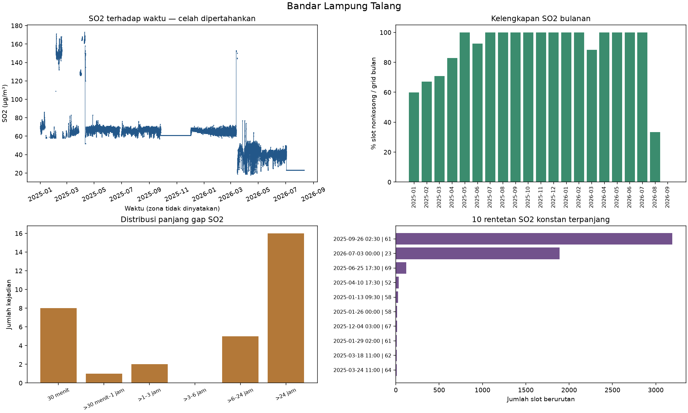
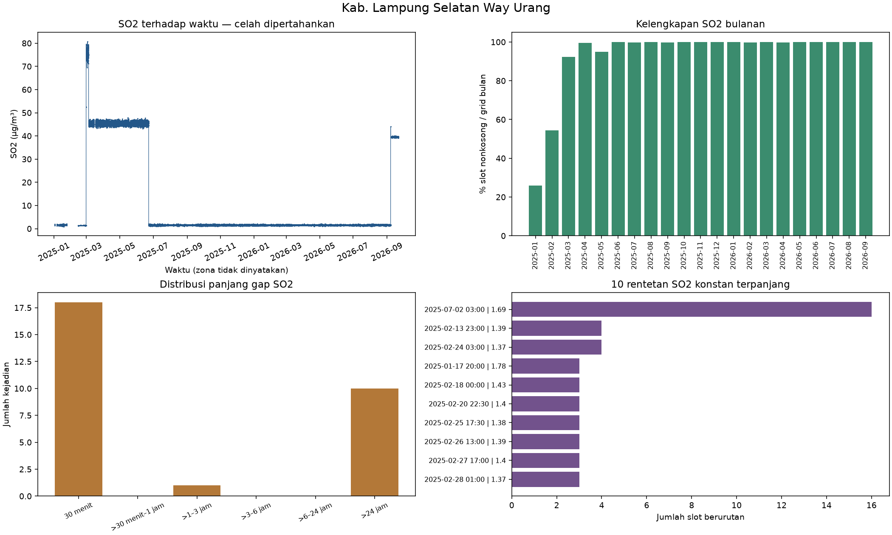
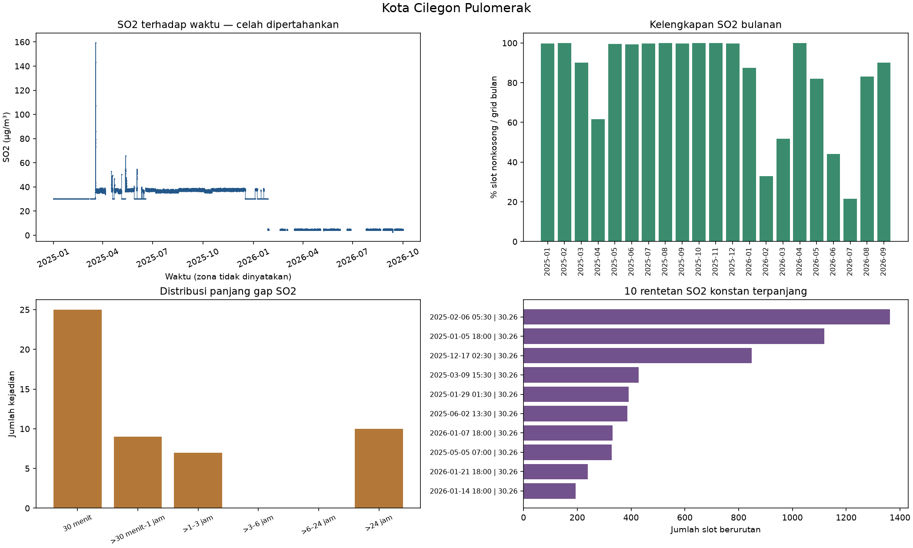
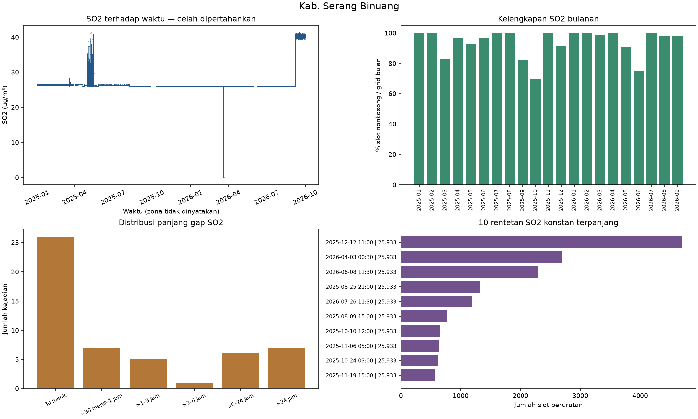
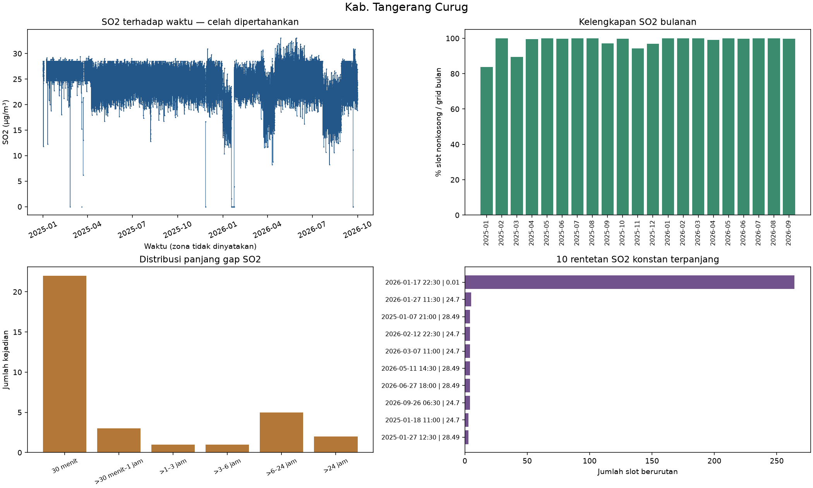
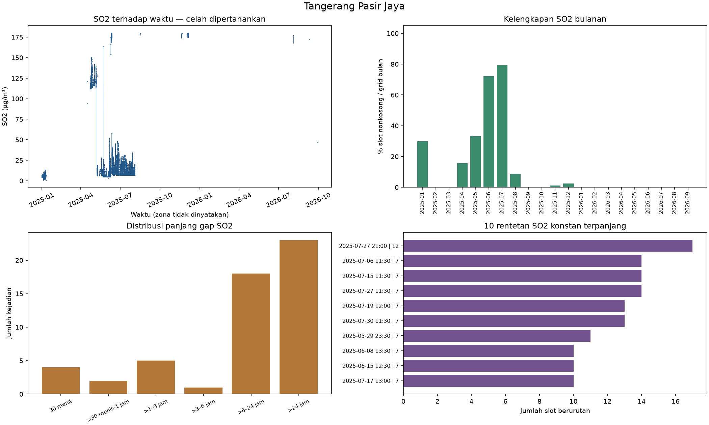
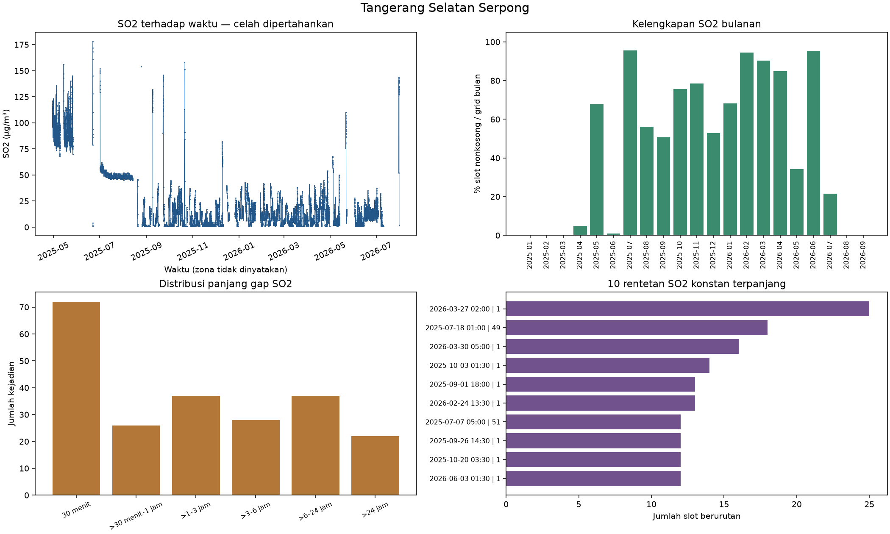
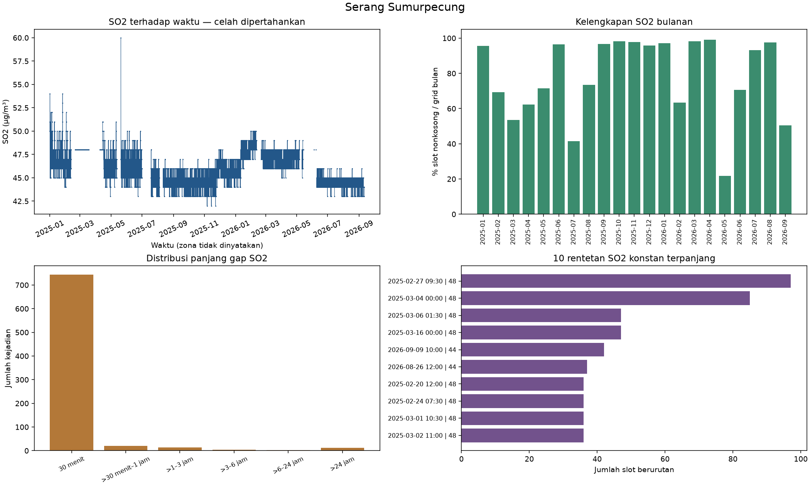

# Ringkasan audit kualitas data SO₂

Audit terpisah untuk setiap stasiun, mengacu struktur notebook 01. File sumber dibaca tanpa modifikasi. Tidak dilakukan imputasi, penghapusan outlier, smoothing, scaling, pemilihan stasiun final atau pelatihan model.

## Definisi dan denominator

- **Sumber:** Excel asli pada data_raw; struktur mengacu notebook 01 dan audit_struktur_data.json. Sumber dibaca read_only, tidak disimpan ulang.
- **Persen kosong variabel:** 100 × jumlah sel kosong / seluruh baris tabel stasiun (termasuk timestamp gagal dan duplikat). Kosong = None, NaN, atau teks hanya whitespace; nol bukan kosong.
- **Grid audit:** Slot menit 00/30 dengan detik dan mikrodetik nol dalam [timestamp minimum, maksimum]. Tidak membulatkan timestamp di luar pola; slot di luar pola dilaporkan terpisah.
- **Persen SO2 teramati:** 100 × slot grid dengan sedikitnya satu nilai SO2 nonkosong / seluruh slot grid. Nonkosong tidak otomatis valid; teks, nol, negatif, ekstrem dan duplikat bertentangan tetap dapat dihitung teramati.
- **Persen tanpa baris:** 100 × slot grid tanpa baris sumber / seluruh slot grid.
- **Persen baris ada SO2 kosong:** 100 × slot grid dengan baris tetapi semua SO2 kosong / seluruh slot grid.
- **Persen hilang SO2:** 100 × (slot tanpa baris + slot baris ada semua SO2 kosong) / seluruh slot grid.
- **Persen bulanan:** Definisi kelengkapan SO2 yang sama, denominator slot grid dalam bulan tersebut; bulan awal/akhir dapat parsial.
- **Duplikat:** Grup berdasarkan timestamp berhasil dibaca; identik jika seluruh 13 nilai pengukuran sama termasuk pola kosong dan tipe Python. Konflik bila ada perbedaan. Baris tambahan = jumlah baris grup − 1; tidak ada baris dihapus.
- **Plot dan konstan:** Slot numerik hanya jika SO2 semua baris pada timestamp setuju dan tidak kosong/nonnumerik/nonfinite. Konflik SO2, sel kosong, atau slot hilang memutus garis dan rentetan. Duplikat SO2 identik ditampilkan sekali hanya pada grid audit.
- **Rentetan konstan:** Kesamaan numerik tepat (tanpa toleransi), minimal 2 slot 30 menit berurutan. Jumlah slot dan rentang akhir−awal dilaporkan terpisah. Per variabel, kosong/konflik/nonnumerik memutus rentetan.
- **Gap SO2:** Rentetan slot grid tanpa SO2 nonkosong. Durasi = jumlah slot × 30 menit; bukan akhir−awal. Satu slot berdurasi 30 menit.
- **Posisi gap:** Sebelum slot SO2 teramati pertama; setelah slot teramati terakhir; tengah seri; atau seluruh seri jika tidak ada SO2 teramati.
- **Kelompok gap:** 30 menit; >30 menit–1 jam; >1–3 jam; >3–6 jam; >6–24 jam; >24 jam. Kelompok deskriptif, bukan batas imputasi.
- **Statistik nilai:** Dihitung per baris sumber dari nilai yang dapat direpresentasikan numerik dan finite; tidak mengganti kolom sumber. Teks numerik dihitung setelah parsing sementara dan dilaporkan tipenya. Jumlah numerik bukan jumlah valid.
- **Nol dan negatif:** Jumlah di antara nilai numerik finite per baris sumber. Tidak dihapus dan tidak diasumsikan salah.
- **Kandidat ekstrem:** Contoh nilai minimum/maksimum setiap variabel, bukan keputusan outlier atau batas sensor.
- **Metadata:** Tanggal laporan tanpa jam dibandingkan secara tanggal kalender; akhir hari inklusif. Zona waktu, kode sensor, ambang sensor dan penyebab anomali tidak disimpulkan.
- **Interval sumber:** Selisih dua baris bertetangga pada urutan asli hanya jika keduanya berhasil dibaca. Timestamp gagal memutus pasangan. Interval unik terurut dihitung terpisah, tanpa mengubah sumber.
- **Persentase lain:** Tidak ada persentase lain selain denominator eksplisit pada tabel dan definisi di atas. Angka 0–100 adalah persen, bukan fraksi Excel.

## Ringkasan per stasiun

| Stasiun | Baris sumber | Slot grid | SO2 teramati slot | Teramati (%) | Tanpa baris | Baris ada, SO2 kosong | Gap terpanjang (jam) |
|---|---:|---:|---:|---:|---:|---:|---:|
| Bandar Lampung Talang | 28226 | 30216 | 26189 | 86.67 | 1990 | 2037 | 1011.5 |
| Kab. Lampung Selatan Way Urang | 29966 | 30171 | 28246 | 93.62 | 206 | 1719 | 490.5 |
| Kota Cilegon Pulomerak | 30399 | 30612 | 25439 | 83.10 | 215 | 4958 | 675 |
| Kab. Serang Binuang | 28732 | 30612 | 28721 | 93.82 | 1886 | 5 | 331 |
| Kab. Tangerang Curug | 30137 | 30612 | 30010 | 98.03 | 479 | 123 | 120.5 |
| Tangerang Pasir Jaya | 23674 | 30612 | 3569 | 11.66 | 6938 | 20105 | 5816.5 |
| Tangerang Selatan Serpong | 25080 | 30612 | 14184 | 46.33 | 5532 | 10896 | 2845 |
| Serang Sumurpecung | 25444 | 30070 | 23711 | 78.85 | 4626 | 1733 | 527 |

### Bandar Lampung Talang

- Waktu aktual: 2025-01-01 00:00:00 sampai 2026-09-22 11:30:00. Urutan nonmenurun: True; meningkat ketat: True.
- Timestamp gagal: 0; grup duplikat identik: 0; konflik: 0; baris tambahan duplikat: 0.
- Di luar pola 00/30: 0; pasangan sumber bukan 30 menit: 29 dari 28225 pasangan terbaca.
- SO2 hilang: 4027 slot (13.33% dari 30216 slot); 32 kejadian. SO2 ambigu pada duplikat: 0 slot.
- Metadata periode: `: 01 Januari 2025 - 22 September 2026`. Awal tanggal sesuai: True; akhir tanggal sesuai: True; baris di luar tanggal metadata: 0.
- Posisi gap (jumlah kejadian): tengah seri: 31, setelah pengamatan terakhir: 1.
- Gap terpanjang: 2026-08-11 08:30:00 sampai 2026-09-22 11:30:00; 2023 slot × 30 menit = 1011.5 jam (setelah pengamatan terakhir).
- Rentetan SO2 konstan terpanjang: 61 µg/m³; 3190 slot, 2025-09-26 02:30:00 sampai 2025-12-01 13:00:00. Belum dinyatakan sebagai kesalahan.
- Pemeriksaan rentang: Kelembaban di luar 0–100%: 0 baris; Arah Angin di luar 0–360 derajat: 0 baris; Kec.Angin negatif: 0 baris.
- Nilai nonnumerik/nonfinite pada kolom pengukuran: 0 sel. Tipe asli, statistik, nol dan negatif tersedia pada tabel Excel.

### Kab. Lampung Selatan Way Urang

- Waktu aktual: 2025-01-01 00:00:00 sampai 2026-09-21 13:00:00. Urutan nonmenurun: True; meningkat ketat: True.
- Timestamp gagal: 0; grup duplikat identik: 0; konflik: 0; baris tambahan duplikat: 0.
- Di luar pola 00/30: 1; pasangan sumber bukan 30 menit: 22 dari 29965 pasangan terbaca.
- SO2 hilang: 1925 slot (6.38% dari 30171 slot); 29 kejadian. SO2 ambigu pada duplikat: 0 slot.
- Metadata periode: `: 01 Januari 2025 - 21 September 2026`. Awal tanggal sesuai: True; akhir tanggal sesuai: True; baris di luar tanggal metadata: 0.
- Posisi gap (jumlah kejadian): sebelum pengamatan pertama: 1, tengah seri: 28.
- Gap terpanjang: 2025-01-24 08:30:00 sampai 2025-02-13 18:30:00; 981 slot × 30 menit = 490.5 jam (tengah seri).
- Rentetan SO2 konstan terpanjang: 1.69 µg/m³; 16 slot, 2025-07-02 03:00:00 sampai 2025-07-02 10:30:00. Belum dinyatakan sebagai kesalahan.
- Pemeriksaan rentang: Kelembaban di luar 0–100%: 0 baris; Arah Angin di luar 0–360 derajat: 0 baris; Kec.Angin negatif: 0 baris.
- Nilai nonnumerik/nonfinite pada kolom pengukuran: 0 sel. Tipe asli, statistik, nol dan negatif tersedia pada tabel Excel.

### Kota Cilegon Pulomerak

- Waktu aktual: 2025-01-01 00:00:00 sampai 2026-09-30 17:30:00. Urutan nonmenurun: True; meningkat ketat: True.
- Timestamp gagal: 0; grup duplikat identik: 0; konflik: 0; baris tambahan duplikat: 0.
- Di luar pola 00/30: 2; pasangan sumber bukan 30 menit: 46 dari 30398 pasangan terbaca.
- SO2 hilang: 5173 slot (16.90% dari 30612 slot); 51 kejadian. SO2 ambigu pada duplikat: 0 slot.
- Metadata periode: `: 01 Januari 2025 - 30 September 2026`. Awal tanggal sesuai: True; akhir tanggal sesuai: True; baris di luar tanggal metadata: 0.
- Posisi gap (jumlah kejadian): tengah seri: 51.
- Gap terpanjang: 2026-06-27 05:00:00 sampai 2026-07-25 07:30:00; 1350 slot × 30 menit = 675 jam (tengah seri).
- Rentetan SO2 konstan terpanjang: 30.26 µg/m³; 1362 slot, 2025-02-06 05:30:00 sampai 2025-03-06 14:00:00. Belum dinyatakan sebagai kesalahan.
- Pemeriksaan rentang: Kelembaban di luar 0–100%: 0 baris; Arah Angin di luar 0–360 derajat: 0 baris; Kec.Angin negatif: 0 baris.
- Nilai nonnumerik/nonfinite pada kolom pengukuran: 0 sel. Tipe asli, statistik, nol dan negatif tersedia pada tabel Excel.

### Kab. Serang Binuang

- Waktu aktual: 2025-01-01 00:00:00 sampai 2026-09-30 17:30:00. Urutan nonmenurun: True; meningkat ketat: True.
- Timestamp gagal: 0; grup duplikat identik: 0; konflik: 0; baris tambahan duplikat: 0.
- Di luar pola 00/30: 6; pasangan sumber bukan 30 menit: 60 dari 28731 pasangan terbaca.
- SO2 hilang: 1891 slot (6.18% dari 30612 slot); 52 kejadian. SO2 ambigu pada duplikat: 0 slot.
- Metadata periode: `: 01 Januari 2025 - 30 September 2026`. Awal tanggal sesuai: True; akhir tanggal sesuai: True; baris di luar tanggal metadata: 0.
- Posisi gap (jumlah kejadian): tengah seri: 52.
- Gap terpanjang: 2025-09-26 17:00:00 sampai 2025-10-10 11:30:00; 662 slot × 30 menit = 331 jam (tengah seri).
- Rentetan SO2 konstan terpanjang: 25.933 µg/m³; 4699 slot, 2025-12-12 11:00:00 sampai 2026-03-20 08:00:00. Belum dinyatakan sebagai kesalahan.
- Pemeriksaan rentang: Kelembaban di luar 0–100%: 259 baris; Arah Angin di luar 0–360 derajat: 43 baris; Kec.Angin negatif: 0 baris.
- Nilai nonnumerik/nonfinite pada kolom pengukuran: 0 sel. Tipe asli, statistik, nol dan negatif tersedia pada tabel Excel.

### Kab. Tangerang Curug

- Waktu aktual: 2025-01-01 00:00:00 sampai 2026-09-30 17:30:00. Urutan nonmenurun: True; meningkat ketat: True.
- Timestamp gagal: 0; grup duplikat identik: 0; konflik: 0; baris tambahan duplikat: 0.
- Di luar pola 00/30: 4; pasangan sumber bukan 30 menit: 41 dari 30136 pasangan terbaca.
- SO2 hilang: 602 slot (1.97% dari 30612 slot); 34 kejadian. SO2 ambigu pada duplikat: 0 slot.
- Metadata periode: `: 01 Januari 2025 - 30 September 2026`. Awal tanggal sesuai: True; akhir tanggal sesuai: True; baris di luar tanggal metadata: 0.
- Posisi gap (jumlah kejadian): tengah seri: 34.
- Gap terpanjang: 2025-01-02 14:00:00 sampai 2025-01-07 14:00:00; 241 slot × 30 menit = 120.5 jam (tengah seri).
- Rentetan SO2 konstan terpanjang: 0.01 µg/m³; 264 slot, 2026-01-17 22:30:00 sampai 2026-01-23 10:00:00. Belum dinyatakan sebagai kesalahan.
- Pemeriksaan rentang: Kelembaban di luar 0–100%: 0 baris; Arah Angin di luar 0–360 derajat: 30 baris; Kec.Angin negatif: 0 baris.
- Nilai nonnumerik/nonfinite pada kolom pengukuran: 0 sel. Tipe asli, statistik, nol dan negatif tersedia pada tabel Excel.

### Tangerang Pasir Jaya

- Waktu aktual: 2025-01-01 00:00:00 sampai 2026-09-30 17:30:00. Urutan nonmenurun: True; meningkat ketat: True.
- Timestamp gagal: 0; grup duplikat identik: 0; konflik: 0; baris tambahan duplikat: 0.
- Di luar pola 00/30: 0; pasangan sumber bukan 30 menit: 98 dari 23673 pasangan terbaca.
- SO2 hilang: 27043 slot (88.34% dari 30612 slot); 53 kejadian. SO2 ambigu pada duplikat: 0 slot.
- Metadata periode: `: 01 Januari 2025 - 30 September 2026`. Awal tanggal sesuai: True; akhir tanggal sesuai: True; baris di luar tanggal metadata: 0.
- Posisi gap (jumlah kejadian): tengah seri: 52, setelah pengamatan terakhir: 1.
- Gap terpanjang: 2025-12-05 02:30:00 sampai 2026-08-04 10:30:00; 11633 slot × 30 menit = 5816.5 jam (tengah seri).
- Rentetan SO2 konstan terpanjang: 12 µg/m³; 17 slot, 2025-07-27 21:00:00 sampai 2025-07-28 05:00:00. Belum dinyatakan sebagai kesalahan.
- Pemeriksaan rentang: Kelembaban di luar 0–100%: 185 baris; Arah Angin di luar 0–360 derajat: 185 baris; Kec.Angin negatif: 0 baris.
- Nilai nonnumerik/nonfinite pada kolom pengukuran: 0 sel. Tipe asli, statistik, nol dan negatif tersedia pada tabel Excel.

### Tangerang Selatan Serpong

- Waktu aktual: 2025-01-01 00:00:00 sampai 2026-09-30 17:30:00. Urutan nonmenurun: True; meningkat ketat: True.
- Timestamp gagal: 0; grup duplikat identik: 0; konflik: 0; baris tambahan duplikat: 0.
- Di luar pola 00/30: 0; pasangan sumber bukan 30 menit: 28 dari 25079 pasangan terbaca.
- SO2 hilang: 16428 slot (53.67% dari 30612 slot); 222 kejadian. SO2 ambigu pada duplikat: 0 slot.
- Metadata periode: `: 01 Januari 2025 - 30 September 2026`. Awal tanggal sesuai: True; akhir tanggal sesuai: True; baris di luar tanggal metadata: 0.
- Posisi gap (jumlah kejadian): sebelum pengamatan pertama: 1, tengah seri: 220, setelah pengamatan terakhir: 1.
- Gap terpanjang: 2025-01-01 00:00:00 sampai 2025-04-29 12:30:00; 5690 slot × 30 menit = 2845 jam (sebelum pengamatan pertama).
- Rentetan SO2 konstan terpanjang: 1 µg/m³; 25 slot, 2026-03-27 02:00:00 sampai 2026-03-27 14:00:00. Belum dinyatakan sebagai kesalahan.
- Pemeriksaan rentang: Kelembaban di luar 0–100%: 3 baris; Arah Angin di luar 0–360 derajat: 3 baris; Kec.Angin negatif: 0 baris.
- Nilai nonnumerik/nonfinite pada kolom pengukuran: 0 sel. Tipe asli, statistik, nol dan negatif tersedia pada tabel Excel.

### Serang Sumurpecung

- Waktu aktual: 2025-01-01 00:00:00 sampai 2026-09-19 10:30:00. Urutan nonmenurun: True; meningkat ketat: True.
- Timestamp gagal: 0; grup duplikat identik: 0; konflik: 0; baris tambahan duplikat: 0.
- Di luar pola 00/30: 0; pasangan sumber bukan 30 menit: 818 dari 25443 pasangan terbaca.
- SO2 hilang: 6359 slot (21.15% dari 30070 slot); 796 kejadian. SO2 ambigu pada duplikat: 0 slot.
- Metadata periode: `: 01 Januari 2025 - 19 September 2026`. Awal tanggal sesuai: True; akhir tanggal sesuai: True; baris di luar tanggal metadata: 0.
- Posisi gap (jumlah kejadian): tengah seri: 795, setelah pengamatan terakhir: 1.
- Gap terpanjang: 2025-03-18 11:30:00 sampai 2025-04-09 10:00:00; 1054 slot × 30 menit = 527 jam (tengah seri).
- Rentetan SO2 konstan terpanjang: 48 µg/m³; 97 slot, 2025-02-27 09:30:00 sampai 2025-03-01 09:30:00. Belum dinyatakan sebagai kesalahan.
- Pemeriksaan rentang: Kelembaban di luar 0–100%: 0 baris; Arah Angin di luar 0–360 derajat: 0 baris; Kec.Angin negatif: 0 baris.
- Nilai nonnumerik/nonfinite pada kolom pengukuran: 0 sel. Tipe asli, statistik, nol dan negatif tersedia pada tabel Excel.

## Keterbatasan dan implikasi rancangan eksperimen

- Tanggal metadata tidak menjelaskan jam, zona waktu, status sensor, kode khusus, batas deteksi atau batas sensor. Kesesuaian tanggal tidak menjamin seri lengkap.
- Grid mencakup minimum sampai maksimum timestamp tiap stasiun, bukan sebelum/di luar cakupan tersebut. Kelengkapan antarstasiun memiliki denominator periode yang berbeda; bulan tepi dapat parsial.
- Timestamp di luar pola 00/30 tidak dipindahkan ke grid. Jika ada, bandingkan hasil grid dengan observasi di luar grid sebelum merancang preprocessing.
- Sel nonkosong adalah teramati, belum otomatis valid. Nol, pengulangan dan SO2 tinggi belum membuktikan kesalahan. Nilai ekstrem minimum/maksimum ditampilkan sebagai kandidat pemeriksaan tanpa batas sensor rekaan.
- Statistik per baris mempertahankan duplikat, sedangkan kelengkapan grid menghitung satu slot per timestamp. Konflik duplikat harus diselesaikan berdasarkan bukti sebelum eksperimen; audit tidak memilih nilai sumber.
- Bandingkan eksperimen berdasarkan panjang dan posisi gap; kelompok gap hanya deskriptif. Gap panjang/pada tepi perlu dipertimbangkan terpisah dari gap pendek di tengah, tanpa menetapkan metode imputasi sekarang.
- Pemisahan train/validasi/test kelak harus kronologis. Rancang estimasi parameter preprocessing hanya dari train dan evaluasi kehilangan sintetis hanya pada observasi yang telah diverifikasi, agar tidak terjadi kebocoran.
- Rentetan konstan, lonjakan, dan rentang meteorologi perlu ditelusuri dengan dokumentasi/penyedia data. Tidak ada dugaan zona waktu, penyebab anomali, atau kaitan dengan aktivitas Anak Krakatau.
- Grafik tidak menghubungkan titik melalui nilai kosong, baris hilang atau SO2 ambigu/nonnumerik. Grid CSV disimpan di outputs/audit_grids khusus audit dan tidak menggantikan file mentah.

## Kendala

- Tidak ada pemeriksaan yang gagal dijalankan.

## Integritas sumber

- File: `data_raw\Telkom University Purwokerto - Intan Azizah.xlsx`
- SHA256 sebelum: `bd00734b954e8df024c048575fad07f1eb1cbe1083d4c8929ae362aeb45a7406`
- SHA256 sesudah: `bd00734b954e8df024c048575fad07f1eb1cbe1083d4c8929ae362aeb45a7406`
- Identik selama audit: True; identik dengan tahap 1: True.
